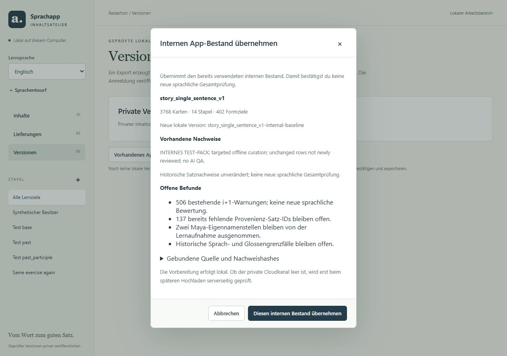

# Erste private Cloudversion aus dem internen App-Bestand

## HTTP 546: Speicherverbrauch lokal belegt und reduziert · 16.10.2026

**Aktueller Stand:** Der echte Bestand wurde in einer isolierten Supabase Edge
Runtime vollständig geprüft. Vorher bricht der zehnte Finalize-Aufruf am
Speicherlimit ab; mit der begrenzten Optimierung erreicht er `ready`.
**Keine Cloudprüfung, kein Deployment und keine Veröffentlichung durchgeführt.**
Der vorhandene lokale Beleg bleibt mit derselben Upload-ID auf `verifying`.
Der konkrete Shutdown-Grund der gemeldeten Cloudinvocation ist weiterhin
unbekannt; der Speicherengpass ist lokal reproduziert, CPU als Cloudursache nicht
behauptet.

### Ablauf, Daten und Ursache

Der aktuelle lokale 546-Job steht bei **processed=9 / total=10**. Die erste
Finalize-Stufe streamt bereits je Aufruf genau eine der neun Dateien und prüft
Bytes, Größe und Hash. Erst der zehnte Aufruf führt `verifyBundle` aus.
Die Bestandsübernahme hat keinen Parent, deshalb werden hier keine früheren
Registry-/Inventardateien nachgeladen. Normale Folge-Releases behalten ihre
zusätzlichen Parent-/Registry-/Historienvergleiche.

| Datei | Bytes | Verarbeitung in der abschließenden Prüfung |
|---|---:|---|
| `pack.json` | 50.083.067 | UTF-8/JSON, Scope/Registrybindung, kompletter normalisierter Inhaltshash und abschließender Packhash |
| `content.sqlite` | 43.085.824 | Bytes vorher separat gestreamt/gehasht; abschließend gebundener SQLitehash/Größe geprüft, kein SQLite-JSON-Parse |
| `history_inventory.json` | 10.169.664 | JSON/kanonischer Sidecarhash, Sprache/Format/Tabellen, gegebenenfalls Parentvergleich |
| `reader_report.json` | 9.808.519 | Byte-/Größen-/Hashprüfung als eine der neun Dateien; kein zusätzlicher JSON-Parse in `verifyBundle` |
| `registry.json` | 1.063.044 | JSON/kanonischer Sidecarhash, Packbindung, gegebenenfalls bisherige Wörter |
| Manifest / Report / Reviews / Provenienz | 1.055 / 1.839 / 3 / 2.575 | JSON, Manifestgleichheit, technische Zulassung, Review- oder Übernahmevertrag, Beleg-/Quellenbindung |

Bisher sammelte `DistributionBackend.object(read=true)` alle rohen Streamchunks
in einer Liste, kopierte sie in einen zweiten Gesamtpuffer und dekodierte diesen
zu einem Gesamtstring vor dem Parse. Das hält zusätzlich die Backingbuffer der
Chunkansichten fest. Inventar, Registry und weitere bereits geparste Dateien
bleiben währenddessen erreichbar. Im isolierten Packtest wurden bereits
253.903.605 externe Bytes gemeldet und `Array buffer allocation failed`
ausgelöst. Die komplette Prüfung überschreitet anschließend das lokale
256-MiB-Limit. Dies ist ein gemessener Speicherabbruch, kein Zeitlimitnachweis.

Weitere unnötige Allokationen im selben Pfad waren die rekursive Bildung eines
großen kanonischen Gesamtstrings je Hash sowie `structuredClone(pack)` nur zum
Weglassen von `release.created_at`. Der Inhalt wird für zwei verschiedene
Prüfzwecke gehasht; beide Bindungen bleiben erhalten.

### Begrenzter Fix und unveränderte Integrität

- Rohbytes werden weiterhin vollständig gehasht und gezählt. JSON wird mit
  einem strikten, zustandsbehafteten UTF-8-Decoder während des Streams dekodiert.
  Es gibt keine Liste festgehaltener Rohchunks und keinen zweiten Gesamtbuffer.
  Parse/Annahme erfolgen nach korrekter Größe und korrektem Bytehash. Das
  bisherige 64-MiB-JSON-Limit bleibt bestehen.
- `digest` produziert dieselbe kanonische Bytefolge mit sortierten Schlüsseln,
  sammelt kleine Schreibteile und übergibt sie in etwa 16-KiB-Blöcken an SHA-256.
  Die großen rekursiven Gesamtstrings entfallen. Einzelne skalare JSON-Werte
  werden weiterhin regulär serialisiert; es wird kein neuer Hashvertrag erfunden.
- Für den normalisierten Packhash werden nur der äußere Container und das
  kleine `release`-Objekt kopiert. Alle Inhaltsdaten bleiben in einer einzigen
  geparsten Struktur; der ursprüngliche Zeitstempel wird separat geprüft und
  bleibt im abschließenden kanonischen Packhash enthalten.
- Alle neun Dateiprüfungen, Übernahme-/Quellen-/Inhalts-/SQLitepins, Registry,
  Reviews, Rechte, Parent-/Generationprüfung und atomarer Commit bleiben erhalten.
  `internal_baseline_source.json` wurde **nicht geändert**. Kein lokaler Bericht
  ersetzt die Serverprüfung. Kein neuer Status und keine verteilte Prüfung nötig.
- HTTP 546 wird im Editor jetzt als Ressourcenabbruch mit offenem konkreten
  Limit erklärt. Bekannte `WORKER_LIMIT`-/`WORKER_RESOURCE_LIMIT`-Codes sind sicher
  lesbar. Ein Abbruch stoppt den Job; der Regressionstest belegt genau einen
  Versuch und Fortsetzbarkeit derselben Upload-ID, keine automatische Wiederholung.

### Reproduzierbare lokale Edge-Messung

Versionierter Helfer: `pipeline/tests/check_content_edge_resources.py`.
Er verwendet das bereits installierte Image
`public.ecr.aws/supabase/edge-runtime:v1.77.1` (Deno 2.1.4), zieht kein Image nach,
kopiert die neun Eingabedateien unverändert in ein eigenes Testverzeichnis und
vergleicht den Gitstand `0670076` mit dem aktuellen Prüfmodul. Gemessen wird der
**tatsächliche `publish`-/Finalize-Pfad**, einschließlich der vollständigen
Byteprüfungen und abschließenden Bundleprüfung, über zehn getrennte Aufrufe.

Userworker-Limits in beiden Läufen identisch: **256 MiB Speicher**, **2.000 ms
CPU soft/hard**, **150.000 ms Wandzeit**, `oneshot`/frischer Worker pro Aufruf.
Keine Limits oder Timeouts wurden zur Abnahme erhöht. Nur isolierte lokale
Auth-/Storage-/DB-Adapter sind synthetisch; die Prüfimplementierung ist echt.
Der Test erzeugt keine Veröffentlichung und ruft kein Cloudprojekt auf.

| Reproduzierter voller Ablauf | Vorher (`0670076`) | Nachher |
|---|---:|---:|
| Aufrufe 1–9, Byte-/Hashprüfung | jeweils HTTP 200 / `verifying` | jeweils HTTP 200 / `verifying` |
| Aufruf 10, Gesamtprüfung | HTTP 546 / Supervisorabbruch | HTTP 200 / `ready` |
| Wandzeit Aufruf 10 | 656.0 ms bis Abbruch | 1375.0 ms vollständig |
| CPU laut Shutdown-Event | 383 ms bis Abbruch | 1.086 ms vollständig |
| Shutdown-Grund | `Memory`, `exceeded=true` | `EarlyDrop`, `exceeded=false` |
| Speicher laut Shutdown | 268.563.353 Bytes, davon 241.320.697 extern | 78.485.951 Bytes, davon 3.038.103 extern |
| Größter erfasster Heap+External-Phasensnapshot | 99.539.369 Bytes **vor** dem fatalen Packladen | 178.106.849 Bytes nach Packparse |

Die Snapshots sind **kein absoluter Peakwert**. Vorher zeigt erst das
Supervisorereignis die Überschreitung; der kleinere vorherige Snapshot wäre kein
Beleg geringeren Verbrauchs. Die CPUwerte sind ebenfalls nicht als Beschleunigung
vergleichbar: vorher wurde früh abgebrochen, nachher vollständig geprüft.
Die `node:process.cpuUsage()`-Stubwerte der ersten Erkundung wurden verworfen;
maßgeblich sind die echten Runtime-Shutdown-Events. Die Daten liegen kompakt in
[resources-546.json](evidence/content-editor-initial-release/resources-546.json).
Die finale Messung benötigt nach Inventar-/Registryparse etwa 528 ms für
Packladen/Decode/Parse; die verbleibende Gesamtprüfung führt die gebundenen
kanonischen Vergleiche vollständig aus. Rohlogs enthalten die Phasensnapshots.

Lokale Grenzen gegenüber der Cloud: andere Hardware/Runtimeversion möglich,
Loopback-I/O, synthetische Auth-/Storage-/DB-Antworten, frische Testworker statt
eines möglicherweise wiederverwendeten Cloudpools. Reale JWT-/RLS-/TLS- und
Cloudlatenzen sind damit nicht abgenommen. Cloud-HTTP-546 allein unterscheidet
CPU/Speicher/Wandzeit nicht; dessen Shutdownmetadaten wurden nicht abgefragt.
Referenz: [Supabase-Limits](https://supabase.com/docs/guides/functions/limits),
[546-Diagnose](https://supabase.com/docs/guides/troubleshooting/edge-function-546-error-response),
[Shutdown-Metriken](https://supabase.com/docs/guides/troubleshooting/edge-function-shutdown-reasons-explained).

Tatsächlich ausgeführt, Windows (PowerShell), aus dem Repository:
```powershell
pipeline\.venv\Scripts\python.exe -X utf8 pipeline/tests/check_content_edge_resources.py --bundle "$env:LOCALAPPDATA\SprachappContentEditor\bundles\088f5eab-7347-406f-b9e6-cf5dbb985990"
```
macOS (Terminal), mit dem dort tatsächlich vorhandenen Bundleverzeichnis:
```sh
pipeline/.venv-macos/bin/python -X utf8 pipeline/tests/check_content_edge_resources.py --bundle '/absoluter/Pfad/zum/bestehenden/Bundle'
```
Output: `before ... call 10 ... http_status: 546`; `after ... call 10 ...
http_status: 200, state: ready`; `Real bundle preserved; local verification passed
at 256 MiB / 2000ms CPU.` **Exit 0.** Messartefakte unter
`build/content_edge_resources/f9098493c2c94587beea72560b6e26a2/`, erste isolierte
Phasenmessungen unter `build/finalize_546/`. Testcontainer wurden entfernt.
Der Helfer bindet nur sein Testverzeichnis read-only und lauscht nur auf
`127.0.0.1:54999`; der echte Editor wird nicht gestartet oder umkonfiguriert.

### Regressionen und geklärte Testfehler

- `deno test --allow-read supabase/functions/_shared/content_distribution_test.ts supabase/functions/_shared/content_baseline_adoption_test.ts`:
  **12 passed / 0 failed (7s), Exit 0**. Kanonische Gleichheit gegen den bisherigen
  Algorithmus inklusive Unicode/großer Felder, split UTF-8, Hash/Größe, beide
  Releasearten und vorhandene Negativprüfungen; echter Packhash unabhängig gegen
  die bisherige kanonische Darstellung verglichen.
- `pipeline/.venv/Scripts/python.exe -X utf8 -m pytest pipeline/tests/test_editor_publisher.py -q --tb=short`:
  **21 passed in 4.98s, Exit 0**. Sichere 546-Meldung, kein automatischer Retry,
  persistierter Fehler und Fortsetzung derselben Upload-ID.
- Die ersten beiden Pythonläufe waren nicht erfolgreich: einmal Jobtesttimeout,
  einmal `PermissionError` beim Jobpolling. Gezielte Reproduktion belegt unter
  Windows: offener Python-Leser blockiert `atomic_json`/`os.replace` mit WinError 5.
  Der Publisher-Testleser nutzt jetzt denselben bereits vorhandenen Schreibmutex;
  die ursprüngliche 90-Sekunden-Grenze bleibt unverändert. Keine produktive
  Store-/Jobimplementierung wurde hierfür geändert. Der grüne Lauf wird deshalb
  nicht als bloße unerklärte Wiederholung gewertet.
- Im ersten Messaufbau verlor eine künstlich neu erzeugte Requestinstanz das
  Runtime-Tag (`streamRid`). Vor der gültigen Messreihe wurde die eingehende
  Requestinstanz direkt weitergeleitet. Dieser Harnessfehler ist kein Bundlefehler.

Pythonpfad für macOS bei gleichem Testbefehl durch
`pipeline/.venv-macos/bin/python` ersetzen; Deno-Befehl identisch.

### Schutz- und Änderungsprüfung

30 vorab gehashte Produktions-/Editor-Dateien einschließlich bestehendem Bundle,
Uploadbeleg und Jobs sowie die Editor-Dateiliste sind unverändert. Der
Bestandsanker ist bytegleich zur zu Beginn angelegten Kopie; der Gitvergleich
bestätigt unveränderten Inhalt (Arbeitsbaum-CRLF separat berücksichtigt).
Neun eigene Dateien werden isoliert committed; fremde Diffabschnitte bleiben
bytegleich und ungestagt. `NEXTSTEPS.md` hat im Arbeitsbaum und Index 25 Zeilen;
nur der eigene Folgestatus wird dem Index hinzugefügt. Eigene und gestagte
`git diff --check` ohne Ausgabe, jeweils Exit 0.

GitNexus für `sprachlernapp` / `C:\Users\ardas\Music\sprachapp`, Basis `0670076`,
aktualisiert: 19.168 Knoten, 41.393 Kanten, 374 erfasste Flows. Datei-Impacts des
Verteilungsvertrags und Publishers LOW; direkte Function-/Testimporte bzw.
Service-/Editorstart betroffen. Die Konzeptabfrage lieferte keinen brauchbaren
Finalize-Flow; direkte Quellen ergänzen diese Graphgrenze. Testdatei-Impact
UNKNOWN wurde über die tatsächlichen pytest-Aufrufe und Testimporte ergänzt.
`detect_changes(scope=all)` vor Commit: 25 Dateien/22 Symbole/303 Prozesszuordnungen;
`scope=staged`: neun eigene Dateien/12 Symbole/303 Zuordnungen. Beide **CRITICAL**,
ohne `error`, `partial` oder `truncated`. Risiko ausdrücklich gemeldet; keine
vollständige statische Ablaufabdeckung oder Cloudfreigabe daraus abgeleitet.

### Jetzt genau fortsetzen

1. Nach gesonderter Deploymentfreigabe ausschließlich **content-publish** neu
   bereitstellen (identisch in PowerShell und macOS-Terminal):
   `supabase functions deploy content-publish --project-ref yevntxclpchapacqdizm`.
   JWT-Verifikation bleibt aktiv. `content-release` verwendet den geänderten
   Hash-/Bundlepfad im Lesehandler nicht; dessen Deployment ist hier nicht nötig.
2. Editor im Startterminal mit **Ctrl+C** beenden und mit aktualisiertem Code,
   derselben Datenablage und bisherigen Authumgebung neu starten. Bei Bedarf
   erneut anmelden. Der Neustart lädt auch die verständliche 546-Meldung.
3. Unter **Versionen** beim bestehenden `story_single_sentence_v1-internal-baseline`
   genau einmal **2 · Serverprüfung** klicken. **Keine neue Bestandsübernahme**,
   **kein erneuter Upload**, **keine Veröffentlichung**.
4. Erst ein tatsächliches `ready` zeigt **Servergeprüft · Veröffentlichung
   ausstehend**. Bei erneutem 546 stoppen und die passenden Shutdownfelder
   `reason`, `cpu_time_used`, `memory_used` einschließlich Ausführungszeitpunkt
   ermitteln; keine Wiederholungsschleife und keine weiteren hypothetischen Fixes.


## HTTP 400 bei „2 · Serverprüfung“ · 16.10.2026

**Ein reproduzierbarer Requestfehler ist lokal behoben; eine erneute Cloudprüfung
wurde nicht ausgeführt.** Der vorhandene Upload bleibt fortsetzbar. Für diesen
Fix ist **kein Function-Deployment erforderlich**: Es ändern sich ausschließlich
der Python-Publisher, Tests und Dokumentation. Der vom Nutzer gemeldete erfolgreiche
Deploy von `content-publish` gehört zum Zustand nach dem vorigen Auftrag.

### Befund und konkrete Ursache

Lesend gefunden: lokales Release `088f5eab-7347-406f-b9e6-cf5dbb985990`, Version
`story_single_sentence_v1-internal-baseline`, Publicationstatus `uploaded`, Upload
`dc4eb268-b9d1-4278-839d-0176d0db2f40`, erwartete Generation 0 und beide Parents null.
Drei vorhandene `private-finalize`-Jobs sind mit `PUBLISH_HTTP_400`, `result=null`,
`processed=0`, `total=10` gescheitert. Das bestehende Neun-Dateien-Bundle besteht
auch jetzt `inspect_bundle` einschließlich Quellen-/Inhaltspins. Keine neue
Bestandsübernahme, kein Umschreiben der tatsächlichen Statusdaten.

Der konkrete Aufrufpfad ist:
`EditorService.publish_release(..., 'finalize')` →
`Publisher.call(upload_id + '/finalize')` → `Publisher._http` →
`content-publish/index.ts` → `handler('publish', ...)` → `publish()`.
Bisher blieb `body=None`; urllib erzeugte somit einen POST ohne JSON-Body.
`publish()` authentisiert zunächst JWT/Publisher und parst danach **für jeden
POST** den Body mit `JSON.parse`. Ein leerer Body löst einen Syntaxfehler aus;
`handler` antwortet darauf mit HTTP 400 / `{"code":"REQUEST_FAILED"}`.
Dieser Fehler liegt vor `backend.upload()` und vor jeder Datei-/Hashprüfung.

Die lokale Reproduktion mit demselben Handler zeigt für normalen Release und
Bestandsübernahme: leerer POST → **400 / REQUEST_FAILED**, null Upload-/Dateizugriffe;
POST mit `{}` → **200 / verifying**, genau die erste Dateiprüfung. `null` und `[]`
bleiben als unerlaubte Anfrageobjekte gesperrt. Der Vertrag wird nicht gelockert.
Die echte Wire-Serialisierung ist zusätzlich in Python geprüft (`data == b'{}'`,
`Content-Type: application/json`). GET bleibt ohne Body; Start-/Commitdaten werden
unverändert übertragen.

Damit ist ein stets fehlschlagender Request im lokalen Code belegt und behoben.
Die **historische Cloudantwort** lässt sich aus den vorhandenen Belegen nicht
rekonstruieren: `_http` hatte ihren Body verworfen, und `handler` übermittelt bei
unbekannten Fehlern ohnehin nur `REQUEST_FAILED`. Ob beim damaligen Cloudaufruf
zusätzlich ein Gateway-/Backendproblem bestand, ist damit nicht behauptet.
Leere Invocations oder Boot-/Shutdownlogs beweisen keine bestimmte Fehlerursache.

### Sichere Diagnose

`PublicationHTTPError.finding()` enthält jetzt zusätzlich `diagnostic` mit
`step`, `http_status`, `server_code` und `reason`. Diese Struktur erreicht über den
bestehenden Servicepfad sowohl den fehlgeschlagenen Job als auch `last_error` am
Publicationbeleg. Der sichtbare Meldungstext enthält dieselben sicheren Angaben,
beispielsweise `Serverprüfung: HTTP 400 · REQUEST_FAILED. Server konnte die
Anfrage nicht verarbeiten.` Der Releasezustand wird dadurch nicht aufgewertet.

Es werden höchstens **16.385 Bytes** gelesen, höchstens **16.384 Bytes** als JSON
akzeptiert. Nur fest freigegebene Vertragscodes oder numerische Fehlercodes
400–599 werden übernommen. Begründungen sind lokale Texte; zwei bekannte
Gatewaymeldungen werden ebenfalls auf lokale Texte abgebildet. Unbekannter
Freitext, fremde Codezeichenfolgen, HTML, fehlerhaftes UTF-8, übergroße Antworten,
Header, Cookies, JWTs, Schlüssel, Pfade und signierte URLs werden nicht reflektiert.
Die vorhandene UI verwendet Textdarstellung, keinen HTML-Import. Die separate
Passwortfehlerbehandlung bleibt erhalten. Fehler bleiben Fehler; eine Testantwort
`ready` wird nicht als erfolgreiche Cloudprüfung ausgegeben.

### Jetzt genau einmal fortsetzen

1. Alten Editor im Startterminal mit **Ctrl+C** beenden. Mit demselben
   Arbeitsverzeichnis und der bisherigen Umgebung neu starten; keinen zweiten
   Editor auf derselben Datenablage öffnen.
2. Windows (PowerShell): `pipeline\.venv\Scripts\python.exe -X utf8 -m sprachpipe.editor`.
   macOS (Terminal): `pipeline/.venv-macos/bin/python -X utf8 -m sprachpipe.editor`.
   Bisherige `--data-dir`-Argumente gegebenenfalls beibehalten.
3. Unter **Versionen** gegebenenfalls erneut mit Passwort anmelden, dann beim
   **bestehenden** `story_single_sentence_v1-internal-baseline` genau einmal
   **2 · Serverprüfung** klicken. Weder erneut übernehmen noch **1 · Privat
   hochladen** oder **3 · Veröffentlichen** anklicken.
4. Bei Erfolg steht **Servergeprüft · Veröffentlichung ausstehend**. Dieser
   Zustand ist hier noch nicht für die Cloud nachgewiesen.
5. Falls es erneut scheitert, den vollständigen **neuen sichtbaren Fehlertext**
   bzw. nur `error.code` und `error.diagnostic` des neuen Jobs mitteilen.
   Benötigt werden Schritt, HTTP-Status, vorhandener sicherer Servercode und
   Begründung. Keine Authdaten oder vollständigen Cloudantworten senden.
   Bei weiterhin bloßem `REQUEST_FAILED` fehlt die interne Exception-Kategorie
   der passenden Invocation; dieser Clientfix allein kann sie nicht ermitteln.
   Das wäre ein neuer, gezielter Diagnoseauftrag, kein Anlass für weitere
   hypothetische Änderungen oder erneute Uploads.

### Tatsächliche lokale Prüfungen dieses Fixes

| Befehl / Prüfung | Relevanter Output | Exit |
|---|---|---|
| `pipeline/.venv/Scripts/python.exe -X utf8 -m pytest pipeline/tests/test_editor_publisher.py -q --tb=short` | `20 passed in 4.38s`; echte urllib-Serialisierung, begrenzte sichere Diagnose, Job-/Belegfortsetzung mit derselben Upload-ID, normale Review-/Bundleprüfungen | 0 |
| `deno test --allow-read supabase/functions/_shared/content_distribution_test.ts supabase/functions/_shared/content_baseline_adoption_test.ts` | `10 passed`, `0 failed (7s)`; leerer Body reproduziert 400, `{}` erreicht Prüfung für beide Arten; Rechte-/Hash-/Review-/Quellen-/Generationtests erhalten | 0 |
| Bestehendes lokales Bundle `inspect_bundle` ausschließlich lesend | `9 files; source/content pins accepted`, weiterhin `uploaded`, ursprüngliche Upload-ID | 0 |

Pythonpfade oben sind Windows-spezifisch; auf macOS
`pipeline/.venv-macos/bin/python` mit denselben Argumenten verwenden.
Rohlogs und Schutzsnapshot liegen unter `build/finalize_http400/`.
Keine Cloudanfrage, Statusmutation, Veröffentlichung, SQL-Änderung oder Deployment
für diese Diagnose ausgeführt; kein Push.


Abschlusskontrolle dieses Fixes: **29** vorab gehashte Produktions-/Editor-Dateien
(einschließlich vorhandenem Bundle, Uploadbeleg und Jobs) unverändert. Die
Editor-Dateiliste wurde nicht erweitert. `git diff --check` für eigene Dateien
und `git diff --cached --check` jeweils ohne Befund, Exit 0; NEXTSTEPS im
Arbeitsbaum und Index jeweils 25 Zeilen. Fünf eigene Dateien isoliert gestagt;
fremde Diffabschnitte unverändert und ungestagt.

GitNexus ist an `sprachlernapp`, `C:\Users\ardas\Music\sprachapp`, Basis `5ec01f8`
gebunden und wurde aktualisiert. Die Konzeptabfrage löste den konkreten Finalize-
Aufruf nicht vollständig auf; direkte Quellen ergänzen diese bekannte Graphgrenze.
Datei-Impact Publisher: LOW, direkter Serviceimport und indirekter Editorstart.
Strukturierte Änderungsprüfung vor Commit: `scope=all` 21 Dateien/24 Symbole/303
Prozesszuordnungen, `scope=staged` fünf eigene Dateien/12 Symbole/243 Zuordnungen,
beide **CRITICAL**, ohne `error`, `partial` oder `truncated`. Die Risikomeldung
wurde ausdrücklich gemeldet und nicht als Low umgedeutet. Keine vollständige
statische Ablaufabdeckung oder erfolgreiche Cloudprüfung daraus abgeleitet.

## Implementiert und lokal geprüft · 16.10.2026

Der genehmigte Erstübernahmeweg `internal-baseline-adoption-v1` ist implementiert.
Er erzeugt nach ausdrücklicher Nutzerbestätigung ein eigenes lokales Release,
ohne `draft_id`, ohne neue Sprachfreigabe und ohne Umschalten von Editorhead oder
Produktionsasset. **In diesem Auftrag entstand nur ein synthetisch bestätigtes
Testrelease in einem isolierten Arbeitsverzeichnis.** Der echte Editor enthält
weiterhin keine von uns registrierte Bestandsübernahme. Keine Cloudaufrufe,
Deployments, Uploads, Veröffentlichungen, Passwortänderungen oder Pushes.

### Jetzt genau klicken

1. Den bisher laufenden Editor in seinem Startterminal mit **Ctrl+C** beenden und
   mit dem aktualisierten Code neu starten. Keinen zweiten Prozess auf demselben
   Arbeitsverzeichnis starten. Die bisherige Datenablage beibehalten.
2. **Versionen** → **Vorhandenes App-Pack als erste interne Version übernehmen**.
3. Quelle `story_single_sentence_v1`, 3.768 Karten, 14 Stapel, 402 Formziele,
   vorhandene Nachweise und offene Befunde lesen. Unter **Gebundene Quelle und
   Nachweishashes** stehen die exakten Bindungen.
4. Nur wenn diese interne Bestandsübernahme gewollt ist: **Diesen internen Bestand
   übernehmen**. **Abbrechen** erzeugt kein Release. Der Hinweis lautet:
   „Übernimmt den bereits verwendeten internen Bestand. Damit bestätigst du keine
   neue sprachliche Gesamtprüfung.“
5. Nach Abschluss steht `story_single_sentence_v1-internal-baseline` in der Liste:
   **Interne Bestandsübernahme · keine neue Sprachprüfung**, Status
   **Lokal vorbereitet · noch nicht hochgeladen**. Bei einem Fehler gibt es
   keinen gültigen Releaseeintrag; die Vorschau kann erneut geöffnet werden.
   Wiederholte Bestätigung derselben gebundenen Quelle liefert das vorhandene,
   erneut geprüfte lokale Bundle statt einer zweiten Version.

Editorstart aus dem Repository, falls bisher der direkte Modulstart verwendet wurde:

Windows (PowerShell):
```powershell
pipeline\.venv\Scripts\python.exe -X utf8 -m sprachpipe.editor
```
macOS (Terminal):
```sh
pipeline/.venv-macos/bin/python -X utf8 -m sprachpipe.editor
```
Die bereits verwendeten Auth-Umgebungsvariablen und gegebenenfalls bisherigen
`--data-dir`-Parameter beibehalten. Für die lokale Übernahme ist kein Login nötig.
Den vorhandenen 181-Ziele-Entwurf weder bestätigen noch exportieren.

### Späteres Deployment und Veröffentlichung – nicht ausgeführt

Nur die schreibende Function **content-publish** braucht für diesen neuen Pfad
neu bereitgestellt zu werden. Beide Einstiege importieren den gemeinsamen Vertrag,
aber `content-release` ruft nur `release()` auf; dessen Reader-/Downloadverhalten
ist unverändert. Der neue JSON-Quellenanker wird statisch aus dem gemeinsamen
Modul importiert und mit der Function gebündelt. Keine SQL-Migration erforderlich:
Die bestehende RPC sperrt den Kanal und vergleicht Generation und beide Parents.

Nach gesonderter Deploymentfreigabe, identisch in PowerShell und macOS-Terminal:
```text
supabase functions deploy content-publish --project-ref yevntxclpchapacqdizm
```
JWT-Verifikation bleibt eingeschaltet; keinen `--no-verify-jwt`-Schalter ergänzen.
Danach im Editor anmelden und beim lokal vorbereiteten Bundle getrennt klicken:

1. **1 · Privat hochladen** → erst nach vollständigem Upload **Hochgeladen ·
   serverseitige Prüfung fehlt**. Der Server muss den leeren Kanal nachweisen.
2. **2 · Serverprüfung** → erst nach vollständiger Prüfung **Servergeprüft ·
   Veröffentlichung ausstehend**.
3. **3 · Veröffentlichen** → Bestätigungsdialog **Jetzt veröffentlichen**.
   Erst erfolgreicher atomarer Commit ergibt **Privat veröffentlicht**.

Ist der Kanal inzwischen belegt, stoppt die Bestandsübernahme mit Konflikt.
Sie ist ausschließlich für Englisch/internal, `internal_test_pack=true`,
Generation 0 und zwei null-Parents zulässig. Hier wurde kein Cloudkanal abgefragt.

### Vertrag und enge Grenzen

- `baseline_adoption.py` löst die Quelle ausschließlich aus dem serverseitigen
  App-Manifest auf. Die HTTP-Anfrage enthält genau `preview_sha256` und
  `accepted=true`; Browser-Dateipfade und zusätzliche Felder werden abgewiesen.
- Der versionierte Anker `supabase/functions/_shared/internal_baseline_source.json`
  wurde aus der aktuellen Manifestquelle und deren echter Schema-5-Konvertierung
  gewonnen. Er bindet Manifest-, Quell-SQLite-, Asset-, Pack-Byte-/kanonischen,
  Registry-, Finalisierungs- und historische QA-Payload-Hashes sowie den gesamten
  konvertierten Inhalt und die SQLite-Bytes. Kein veralteter Versionspfad wird
  vom Browser ausgewählt. Eine neue Manifestquelle oder abweichender Exporter
  sperrt diesen engen v1-Pfad und benötigt eine gesondert geprüfte Ankeränderung;
  es gibt keine automatische Neuberechnung vertrauenswürdiger Hashes im Betrieb.
- Der konvertierte Inhaltsdigest umfasst alle fachlichen Felder, IDs, QA-Payloads,
  Lernbarkeit, Formfunktionen, Wortbesitz, Zuordnungen und technischen Snapshots
  einschließlich Historie. Nur `release.created_at` wird getrennt auf den festen
  technischen Reproduzierbarkeitswert `2026-10-16T00:00:00Z` geprüft. Dieser Wert
  bezeichnet keine tatsächliche Prüfung oder Nutzerbestätigung. Der echte lokale
  Bestätigungs- und Registrierungszeitpunkt wird separat erfasst.
- Die Bytebindung wurde unter Python/SQLite **3.40.1** geprüft. Ein anderer
  SQLite-/Exporterstand kann andere Bytes erzeugen und wird dann ausdrücklich
  blockiert. macOS-Ausführung dieses neuen Builds wurde nicht behauptet.
- `editorial_reviews.json` bleibt leer. Die Validierung lautet
  `technical=valid`, `editorial=existing-evidence-only`. `provenance.json`
  enthält den hashgebundenen Übernahmebeleg mit ausdrücklicher Bestätigung,
  vorhandenen Nachweisen und offenen Befunden. Kein erfundener Reviewer,
  keine `scope=draft`-Sprachfreigabe und kein `editorial=approved`.
- Gemeinsame Bundlemechanik wurde aus `build_release` extrahiert; dessen normale
  Zulassung bleibt technisch gültig **und** redaktionell bestätigt. Die eigene
  Übernahmefunktion verwendet dieselbe Konvertierung, 23-Tabellen-Readback,
  Dart-Reader-/Historienprüfung und das bestehende Neun-Dateien-Bundle.
- Lokale Registrierung erfolgt erst nach vollständiger Prüfung; Stagingreste
  werden bei Fehlern entfernt. Entwürfe/Reviews/Editorhead werden nicht angepasst.
  Der neue Releaseeintrag führt seine Art statt einer fingierten `draft_id`.
- Serverstart und Finalisierung prüfen den leeren Kanal. Beim Commit bleibt die
  bestehende SQL-Transaktion mit Kanalzeilensperre und CAS maßgeblich; ein paralleler
  Gewinner macht den anderen Versuch zum Konflikt. JWT, Rechte, RLS, Dateisatz,
  Größen-/Hashprüfung und normaler Reviewvertrag bleiben erhalten.
- Geprüfte Zustände sind getrennt: Ein lokales Bundle behauptet **keinen** leeren
  Cloudkanal. Das Verhalten wurde mit injizierten Testtransporten und einer
  wegwerfbaren lokalen SQL-Datenbank geprüft, ohne Cloudzugriff.

### Tatsächliche Abnahme

Befehle aus dem Repository; Pythonpfad hier Windows. Unter macOS durch
`pipeline/.venv-macos/bin/python` ersetzen; Dart/Deno/Flutter sind identisch.
Dart-basierte Prüfungen unter Windows **nacheinander** ausführen, da deren
Native-Asset-Buildhook dieselbe `sqlite3.dll` verwendet. Keine Timeouts erhöht.

| Tatsächlicher Befehl | Relevanter Output | Exit |
|---|---|---|
| `pipeline/.venv/Scripts/python.exe -X utf8 -m pytest pipeline/tests/test_editor_service.py pipeline/tests/test_editor_publisher.py pipeline/tests/test_baseline_adoption.py -q --tb=short` | `24 passed in 42.10s` | 0 |
| `pipeline/.venv/Scripts/python.exe -X utf8 -m pytest pipeline/tests/test_baseline_adoption_http.py -q --tb=short` | `1 passed in 3.19s`; Authpflicht, Vorschau, keine freien Pfade/implizite Bestätigung | 0 |
| `pipeline/.venv/Scripts/python.exe -X utf8 build/baseline_adoption/real_build.py` | Vollständiger finaler Realbuild; 23 Tabellen; unveränderter Testentwurf und Testhead; synthetische Bestätigung | 0 |
| `deno test --allow-read supabase/functions/_shared/content_distribution_test.ts supabase/functions/_shared/content_baseline_adoption_test.ts` | `9 passed`, `0 failed`; echte Quelle, Inhalts-/Beleg-/SQLite-Manipulation, Kanalgrenze | 0 |
| `pipeline/.venv/Scripts/python.exe -X utf8 pipeline/tests/check_baseline_adoption_cas.py` | `2 concurrent generation-0 commits; 1 winner, 1 conflict; generation=1; catalog=1; retry idempotent`; Rechte/Parents/Generation abgewiesen, Testdatenbank entfernt | 0 |
| `flutter test --no-pub test/data/real_pack_test.dart` | `+1: All tests passed!`; 14 Stapel, 3.767 Karten, 203 Alternativen | 0 |
| `dart run tool/stage_content_pack.dart --verify` | `verified assets\content\en\content.sqlite`; Schema 4, 26.198.016 Bytes, `22 table counts match finalization_report.json` | 0 |
| `flutter test --no-pub test/data/baseline_adoption_pack_test.dart` | `+1: All tests passed!`; neues Manifest/23-Tabellen-Inventar und Schema-4-Historie akzeptiert; Asset unverändert | 0 |
| `node --check pipeline/src/sprachpipe/editor/web/app.js` | Keine Syntaxfehler | 0 |
| `pipeline/.venv/Scripts/python.exe -X utf8 build/content_initial_release/verify_protection.py` | 13 geschützte Dateien, davon acht echte Editor-Datendateien, unverändert; Editor-Dateiliste identisch; NEXTSTEPS 25 Zeilen | 0 |

Nach Ergänzung der getrennten Zeitstempel-/SQLite- und Validierungsbindung erneut gezielt geprüft:
`pipeline/.venv/Scripts/python.exe -X utf8 -m pytest pipeline/tests/test_baseline_adoption.py pipeline/tests/test_baseline_adoption_http.py -q --tb=short`: **5 passed in 30.44s**, Exit 0.
Der Deno-Gegencheck erneut **9 passed / 0 failed (8s)**, Exit 0.

Der reproduzierbare Realbuild-Helfer liegt jetzt unter
`pipeline/tests/check_baseline_adoption_real.py`: Jeder Lauf erzeugt ein neues
isoliertes Testarbeitsverzeichnis und schreibt `build/baseline_adoption/real-result.json`
für den expliziten Deno- und Flutter-Integrationstest. Diese beiden Integrationstests werden ohne erzeugtes Testbundle ausdrücklich übersprungen; bei dieser Abnahme liefen sie vollständig. Niemals dessen synthetisches Testrelease
in den echten Editor kopieren. Rohlogs liegen in `build/baseline_adoption/`.

Aufgetretene Fehler wurden geklärt: Der erste unabhängige Referenzexport hatte
unterschiedliche automatisch erzeugte `content_releases.created_at`-Werte;
der feste technische Zeitpunkt behebt diese Metadatenabweichung. Der erste
parallele Pythonlauf ergab 22 PASS/2 Setupfehler wegen der offenen Windows-DLL
(`PathAccessException`, Zugriff verweigert); nach Ende des anderen Dart-Readers
bestand der sequenzielle Lauf. Der neue HTTP-Test benötigte noch den expliziten
Import seiner `setup`-Fixture; danach bestand er. Kein Timeout wurde erhöht.

Die reale Konvertierung liest 3.767 aktive Ziele und 4.297 historische Kontexte;
402 Formziele/Formmitgliedschaften und acht aus bestehenden QA-Nachweisen
übernommene Storykorrekturen sind erhalten. 137 alte Provenienzlücken, 506 alte
`i+1`-Warnungen, die zwei Maya-Stellen und weitere Sprach-/Glossengrenzfälle bleiben
sichtbar offen; sie werden weder als neue Verluste noch als behoben ausgewiesen.

Browserprüfung im separaten synthetischen Editor: Vorschau mobil und 1280px Desktop,
Quellenbindung/Altbefunde/Bestätigungstext sichtbar, Abbrechen ohne Release.


### Abschließende Änderungsprüfung und Isolation

GitNexus für `sprachlernapp` / `C:\Users\ardas\Music\sprachapp`, Basis `848986c`:
Reindex erfolgreich (19.102 Knoten, 40.736 Kanten, 374 erfasste Flows).
Exakte Datei-Impacts: Autorendienst MEDIUM, Editorservice/Server/Publisher und
Distribution LOW; reine Symbolnamen lieferten falsche Referenzkopien bzw. UNKNOWN.
Die erste Namensabfrage `build_release` meldete HIGH und wurde ausdrücklich
gewarnt. UNKNOWN wurde anhand konkreter Service-/HTTP-/JS-/Function-Aufrufe
aufgelöst. Der Index meldet weiterhin begrenzte dynamische/cross-language
Auflösung und ausgelassene Flows; eine leere Kante gilt nicht als unbenutzt.

Strukturierte `detect_changes(scope=all)` vor Commit: 38 Dateien, 48 Symbole,
303 zugeordnete Prozesse, **CRITICAL**. `scope=staged`: genau 22 eigene Dateien,
38 Symbole, 303 Prozesse, ebenfalls **CRITICAL**. Beide Abfragen ohne `error`,
`partial` oder `truncated`; die eigenständigen Index-Abdeckungsgrenzen bleiben.
Das Integrationsrisiko wurde ausdrücklich gemeldet und nicht heruntergestuft.

`git diff --cached --check`: Exit 0 nach Entfernen einer zusätzlichen Leerzeile
am Ende des neuen Testhelfers. 16 fremde Diffabschnitte sind bytegleich erhalten.
NEXTSTEPS enthält im Arbeitsbaum und Index jeweils 25 Zeilen. Sein fremder
Arbeitsbaumanteil bleibt ungestagt; der Index erhält alle bisherigen HEAD-Fakten,
verlustfrei zusammengerückt, sowie die drei eigenen Erstübernahmezeilen.

Zusätzlicher Vergleich der tatsächlichen Readerberichte:
`current identical: True`, `historical identical: True`,
`story_display identical: True`. Die Übernahme prüft aktive Readeransichten auch
im Build ausdrücklich. Der Stand von 13 geschützten Dateien einschließlich acht
echter Editor-Datendateien und deren Dateiliste blieb unverändert.

## Archiv: rein lesende Voruntersuchung vor der Implementierung

Die folgenden Befunde und damaligen Handlungsempfehlungen dokumentieren den
Ausgangszustand. Der oben beschriebene implementierte Weg ersetzt den damaligen
Vorschlag; die Inhaltsbefunde und der Nachweis der 181 Ziele gelten weiter.


Stand: 16.10.2026, Checkout `C:\Users\ardas\Music\sprachapp`, Commit `848986c`.
**Ergebnis: Für diesen unveränderten internen Schema-4-Bestand gibt es noch keinen
unterstützten Erstübernahmeweg ohne neue lokale redaktionelle Freigabe.**
Generation 1 ist serverseitig vorgesehen, setzt aber bereits ein gültiges
Schema-5-Releasebundle voraus. Deshalb wurde kein Bundle durch eine erfundene
Bestätigung erzeugt und nichts hochgeladen. Dieser Bericht enthält einen
Änderungsvorschlag, keine implementierte oder freigegebene neue Funktion.

## Was jetzt konkret zu tun ist

1. Im Dialog **Redaktionell bestätigen** auf **Abbrechen** gehen, solange die
   dort behauptete Prüfung nicht tatsächlich stattgefunden hat. Keine Prüfperson
   oder Prüfnotiz ersatzweise eintragen. Der vorhandene Entwurf bleibt erhalten.
2. **Versionen** kann geöffnet und die vorhandene Anmeldung weiterverwendet werden.
   Die leere Liste bedeutet: Es existiert kein registriertes lokales Releasebundle.
   Anmeldung oder **Nach Updates suchen** in der App erzeugen keine erste Version.
3. Zuerst den unten abgegrenzten Auftrag **„Interne Bestandsübernahme als
   Erstversion implementieren, ohne neue Sprachfreigabe“** freigeben.
   Einen passenden Übernahmebutton oder CLI-Befehl gibt es derzeit nicht.
   Nach Implementierung und lokaler Prüfung wäre das neue Bundle separat
   hochzuladen, serverseitig zu prüfen und ausdrücklich zu veröffentlichen.

Insbesondere jetzt nicht **Prüfung bestätigen**, **Export starten** mit dem
Releaseformat, **Asset gesichert übernehmen** oder einen manuellen Datei-/SQL-Import
als Ersatz für diese fehlende Funktion verwenden. Die normale Entwurfsfreigabe
bleibt für tatsächlich redigierte Inhalte weiterhin der richtige Weg.

## Die 181 Ziele: konkrete Daten statt vermuteter Änderungen

Es wurde ausschließlich der bestehende Dateistand gelesen. Kein zweiter
`EditorService`/`EditorStore` wurde auf dem Arbeitsverzeichnis gestartet; solche
Starts könnten Sperrdatei, Jobs oder Wiederherstellungsbelege verändern.
Keine Browsernavigation wurde automatisiert, weil sie die Auswahl speichern kann.

Arbeitsverzeichnis: `%LOCALAPPDATA%\SprachappContentEditor`.
`workspace-view.json` wählt Englisch, Stapel `allgemeine-sprache`, Entwurf
`2139ad7f-d6f1-4787-9fff-146cf050c509`. `current.json` verweist auf Revision 2.

| Prüfung | Gelesener Befund |
|---|---|
| Stapel | „Allgemeine Sprache“, Anfänger, Positionen 1–181 |
| `target_refs` | 181 Einträge, 181 verschiedene Referenzen; exakt alle aktiven `deck_cards` dieses Stapels, in derselben Reihenfolge |
| Inhaltliche Änderungen | `operations=[]`, `add={}`, `delivery_ids=[]`, `provenance=[]`; keine Ergänzung und kein Import |
| Lokale Freigaben | `reviews=[]` |
| Revision 1 → 2 | Nur `revision`, `updated_at`, `validation` geändert; keine fachlichen Felder |
| Inhaltshash beider Revisionen | `cd1904b28f2e9f202e91012d096d7bd8403187a192ecb319ebc550f5f81323fd` |
| Gespeicherte Validierung | `technical=valid`, `editorial=open`, 40 `i+1`-Warnungen, keine Fehler |
| Bindung des Prüfberichts | Eigener Berichtshash und Inhaltshash nachgerechnet, beide stimmen |
| Basis und Quelle | Gespeicherter Basispack ist strukturell identisch mit dem manifestgebundenen `pack.json`; Rohdateihash und lokaler Head stimmen ebenfalls |
| Lokale Veröffentlichung | 0 Einträge unter `releases/`; kein `bundles/`-Verzeichnis |

Beispiele aus der vollständigen Liste:

| Position | Form | Exakte Referenz |
|---|---|---|
| 1 | the | `the\|the/DET\|the#bestimmter_artikel` |
| 2 | to | `to\|to/ADP\|to#nach_richtung` |
| 3 | and | `and\|and/CCONJ\|and#und` |
| 181 | written | `irregular:write:past_participle` |

Alle 181 Referenzen mit Position, Form, Hinweis, aktivem Satz und bestehenden
QA-Metadaten stehen in [draft-audit.json](evidence/content-editor-initial-release/draft-audit.json).
Die Zahl bezeichnet den ausgewählten Reviewumfang, **nicht 181 neue oder fehlerhafte
Aufgaben**. Der gespeicherte Bericht nennt `draft_revision=1`, weil die damalige
technische Validierung erst anschließend als Revision 2 gespeichert wurde.
Der identische Inhaltshash belegt hier keinen zwischenzeitlichen Inhaltswechsel.

### Weshalb die Bestätigung verlangt wird

- `EditorService.new_draft` (`pipeline/src/sprachpipe/editor/service.py:105`)
  übernimmt beim Kopieren eines Stapels alle aktiven Mitgliedschaften in
  `target_refs` und setzt `reviews` leer. Es filtert dort nicht nach Änderungen.
- `review()` in `editor/web/app.js:130` nennt unmittelbar die Länge von
  `target_refs` und fordert Satz, Übersetzung, Lücke, Bedeutungen, Kontextglossen
  und Alternativen zu prüfen. Der Dialog trifft keine Aussage aus einem Diff.
- `validate_draft` (`authoring_service.py:462`) behandelt technische Befunde und
  redaktionelle Entscheidung getrennt. `editorial=approved` entsteht nur durch
  einen vorhandenen `decision=approved` mit passendem `draft_content_hash`.
  QA-Metadaten in alten Sätzen werden nicht automatisch zu einer neuen
  `scope=draft`-Bestätigung des aktuellen Entwurfs.
- `EditorService.review` bindet eine ausdrücklich eingegebene Prüfperson/Notiz an
  den aktuellen Inhaltshash. `build_release` (`authoring_service.py:530`) fordert
  danach ausdrücklich technisch gültig **und** redaktionell bestätigt;
  sonst `RELEASE_BLOCKED`. Auch ein neuer Entwurf ohne Stapel/mit null Zielen
  ersetzt diese Freigabeanforderung nicht.

Das entspricht der Trennung im [Editorvertrag](content-editor-contract.md),
Abschnitte 3 und 10. Es liegt hier keine neue Bearbeitung vor, sondern eine
fehlende eigene Workflowart für die Übernahme eines bereits intern verwendeten
Bestands. Die bestehende Prüfung wird deshalb nicht ausgeschaltet.

## Maßgebliche Quelle und vorhandene Nachweise

Die Quelle wurde aus `assets/content/en/content.manifest.json` aufgelöst,
nicht aus einem Versionsnamen geraten oder aus dem älteren Paketbericht übernommen.

| Bindung | Aktueller Wert |
|---|---|
| Version / Assetformat / Schema | `story_single_sentence_v1` / 1 / 4 |
| SQLitequelle | `pipeline/out/story_single_sentence_v1/content.sqlite` |
| SQLitegröße | 26.198.016 Bytes |
| SQLite-SHA256, Quelle und Asset identisch | `b85793932825a22e92ac744a42255e9f333acd35809aaba46edb5a395f099bdb` |
| Assetmanifest-SHA256 | `74a0bce4d16bb3084f762dd6afc69accc44c80db545dba9871b21d0b8c7adbfe` |
| Quell-`pack.json`, Bytehash | `313ea762423478c932cb3c92a512ffd07281afed9028a17b9f6ec3a00b7a9aa5` |
| Quell-`pack.json`, kanonischer Hash | `fd3ce96b3472d083ca07d7adbcfed5ec82975db1a451a967073510e9a01932fb` |
| Registryhash | `4736bf4819a17cdabd5f57a60f08f53760ade24ef45e87464e1fcbeaa39dc97e` |

Der Quellordner enthält genau `content.sqlite`, `pack.json` und
`finalization_report.json`. Der Releasehinweis lautet bereits ausdrücklich:
`INTERNES TEST-PACK: targeted offline curation; unchanged rows not newly reviewed; no AI QA.`

Die Nachweise haben unterschiedliche Geltungsbereiche:

1. **Technische Finalisierung:** vorhandener Bericht `status=ok`, Linter
   0 Fehler/506 `i+1`-Warnungen, 22 Tabellen, `ai_calls=0`. Dies ist keine
   sprachliche Gesamtfreigabe. Zwei dokumentierte Storystellen „Maya“ bleiben
   als Eigennamen von der Lernaufnahme ausgenommen.
2. **Bestehende Satznachweise:** im Gesamtpack 602 Sätze mit `qa_status=ok` und
   3701 mit `editorial_reviewed`; alte/historische Sätze sind darin enthalten.
   Für die 181 aktiven ausgewählten Aufgaben sind es 131 `ok` und 50
   `editorial_reviewed`. Bei den 50 stehen 29 `editorial`- und 21
   `editorial_create`-Nachweise. Diese Metadaten werden hier gezählt und erhalten,
   nicht erneut inhaltlich bewertet oder zu menschlichen Zertifikaten umbenannt.
   Beispielsweise grenzt ein vorhandener `editorial`-Nachweis seine Herkunft
   ausdrücklich als Chat-Modellreview mit `human_approval=false`,
   `vertex_validation=false` und `public_release=false` ab.
3. **Gezielte historische Änderungen:**
   [Kontextkorrekturen](context-quality-applied-v1.md) dokumentieren genau ihre
   drei Operationen und die weiter offenen Befunde;
   [Story-Einzelsätze](story-single-sentence-v1.md) dokumentiert 14 damalige
   Wortstellen/acht geänderte Kontexte. Die Ein-Satz-Lieferung liegt unter
   `pipeline/data/curation/story_single_sentence_v1.json`; sie ist keine
   Freigabe aller Stapel.
4. **Offene Altbefunde:** 137 bereits vorhandene fehlende Provenienz-Satz-IDs
   und die früher dokumentierten Sprach-/Glossengrenzfälle bleiben offen.
   Der bestehende Read-only-Audit wurde erneut ausgeführt und bestätigt
   unverändert 137 Lücken, 530 historische Links und 402 Formmitgliedschaften.
   Eine interne Übernahme muss das sichtbar mitführen; technische Gültigkeit
   darf diese Befunde nicht verschwinden lassen.

## Unterstützter Weg und konkrete Lücke

| Stufe | Bestehendes Verhalten | Konsequenz für dieses Pack |
|---|---|---|
| Editorstart | `install_base` registriert nur Basis und Sprachhead | Keine automatische lokale Releaseversion aus dem App-Asset |
| Versionsliste | `GET /api/v1/releases` liest `EditorStore.list('releases')` | `pipeline/out/` und Assets werden nicht als Releases aufgelistet |
| Releaseexport | `POST /drafts/{id}/releases` → `EditorService.release` → `build_release` | Gebundene Entwurfsfreigabe, Schema-5-Konvertierung, Reader-/Historienprüfung und neun Dateien erforderlich |
| Lokales Hochladen | `publish_release` lädt `draft_id`, prüft exportierte Revision und `inspect_bundle` | Keine Registrierung eines unabhängigen Bestandsbundles ohne Entwurf unterstützt |
| Cloudstart | `validateStart` in `_shared/content_distribution.ts:23` | Manifestformat 2, Schema 5, englisches Profil, internes Pack und exaktes Neun-Dateien-Set erforderlich |
| Cloudfinalisierung | `verifyBundle` in `_shared/content_distribution.ts:94` | `validation.editorial=approved` und an den Inhaltshash gebundener Review erforderlich |
| Erste Generation | Erwartete Generation 0 und null Parent werden akzeptiert | Dies ermöglicht die erste Veröffentlichung eines **schon vertragsgültigen** Bundles, keinen Legacy-/Review-Sonderfall |

`supabase/functions/content-publish/index.ts` ist nur der Einstieg; die tatsächlichen
Prüfungen stehen im gemeinsam verwendeten `_shared/content_distribution.ts`.
Die neun Dateien sind: `content.sqlite`, `pack.json`, `registry.json`,
`history_inventory.json`, `editorial_reviews.json`, `provenance.json`,
`finalization_report.json`, `content.manifest.json`, `reader_report.json`.
Sechs davon fehlen als eigenständige Dateien im Quellordner; die vorhandenen drei
haben zudem den alten Vertrag. Registrydaten und QA-Nachweise sind teilweise im
Quellpack enthalten, aber kein Ersatz für die gebundenen Release-Sidecars.

Weder ein ZIP-/XLSX-Austauschexport noch das technische Assetstaging registriert
dieses Cloudbundle. Die ältere CLI `upsert --publish` schreibt Tabellenzeilen;
sie ist kein privater Release-/Storage-/Kanalweg und wurde nicht ausgeführt.
Manuelles Anlegen von Release-JSONs oder Revieweinträgen wäre eine Umgehung.
Cloudkanal/Generation wurden in diesem Auftrag nicht abgefragt; der spätere
Erstübernahmeweg muss Generation 0 serverseitig beweisen und bei einem inzwischen
belegten Kanal abbrechen.

## Kleinster konkreter Änderungsvorschlag — noch freizugeben

**Eine gesonderte interne Erstübernahmeart ergänzen; den normalen
Entwurfs-Reviewvertrag unverändert lassen.** Keine neue Autharchitektur,
kein Direktzugriff auf private Cloudtabellen, keine neue Sprachprüfung.

1. Eine lokale Aktion unter **Versionen**, beispielsweise **Internes App-Pack als
   Erstversion vorbereiten** (Vorschlagsname, heute nicht vorhanden). Der Dienst
   löst die Quelle ausschließlich aus dem vertrauenswürdigen App-Manifest auf
   und zeigt Version, Quellhashes, bestehende Nachweise und offene Befunde.
   Der Browser liefert keinen freien Dateipfad. Bei fehlender Quelle, Hashabweichung
   oder unvollständigen Nachweisen abbrechen, nicht auf einen anderen Pack raten.
2. Ein ausdrücklich eigener Übernahmebeleg: Art
   `internal-baseline-adoption-v1`, Quelle/Manifest/Pack-/Registryhashes,
   vorhandene Nachweisdateien mit Hash und tatsächlichem Prüfumfang, offene
   Befunde sowie später eine **wirklich vom Nutzer eingegebene** Bestätigung
   „diesen bereits verwendeten internen Bestand übernehmen“. Keine Prüfperson,
   Notiz oder sprachliche Entscheidung automatisch erzeugen. Keine neue
   `scope=draft`-Freigabe; bestehende Entwürfe und deren Reviews bleiben unangetastet.
3. Bestehende Schema-4→5-Konvertierung, SQLite-Readback, Dartreader und
   Historienvergleich wiederverwenden. Neues unveränderliches Bundle nur in
   einem eigenen temporären/lokalen Releaseverzeichnis erzeugen, ohne
   Produktionsasset oder aktuellen Editorhead umzuschalten. Identitäten,
   Lernbarkeit, aktive/historische Anzeigen und QA-Payloads müssen erhalten
   bleiben. Neue technische Snapshotspalten und Release-Metadaten sind separat
   auszuweisen; der Schema-5-SQLitehash wird sich ändern. Bei irgendeiner
   fachlichen Abweichung den Übernahmeweg sperren und zum normalen Reviewweg führen.
4. Bestehendes Neun-Dateien-Bundle behalten. Quellenbindung, Hashes und der
   ehrliche Übernahmebeleg gehören in `provenance.json`/Finalisierungsbericht und
   werden im Manifest gebunden. Historische Satznachweise bleiben unverändert
   im Pack. `editorial_reviews.json` enthält keine neu erfundene Freigabe;
   der neue Bericht muss „vorhandene Nachweise/keine neue Sprachprüfung“
   ausdrücklich von `technical=valid` unterscheiden. Keine Umdeutung zu
   `editorial=approved`. Den genauen additiven Belegvertrag vor Implementierung
   mit Positiv-/Negativfixtures festlegen.
5. Lokalen Release-Datensatz eindeutig als Bestandsübernahme kennzeichnen.
   `publish_release`/`inspect_bundle` prüfen dafür den unveränderlichen
   Übernahmebeleg statt einen fingierten `draft_id` zu verlangen. Normale
   Datensätze behalten exakt ihre bisherigen Revisions-/Reviewprüfungen.
6. Cloudprüfung nur für diese deklarierte Art additiv erweitern: englischer
   `internal`-Kanal, `internal_test_pack=true`, Generation 0, beide Parents null,
   vollständige Quellen-/Nachweisbindung und expliziter Übernahmebeleg zwingend.
   JWT, Publisher-/Reader-Allowlist, Hash-/Größen-/Dateisatzprüfung,
   Finalize/Commit-CAS und RLS unverändert. Nach belegtem Kanal darf dieser
   Sonderweg nicht erneut funktionieren; normale Folgeversionen brauchen
   weiterhin ihre bisherige Freigabe. Das erfordert eine spätere gezielte
   Anpassung/erneute Bereitstellung von `content-publish`, keinen heutigen
   Cloudzugriff und voraussichtlich keine SQL-Migration (Beleg in vorhandenen JSON-Feldern).

Gezielt betroffene Implementierungsdateien eines späteren Auftrags:
`editor/service.py`, `editor/server.py`, `editor/publisher.py`, `editor/web/app.js`,
`authoring_service.py` für getrennte Buildvoraussetzungen,
`functions/_shared/content_distribution.ts` für den tatsächlichen Cloudvertrag
sowie zugehörige Tests/Vertragsdokumentation. `EditorStore.put/list` kann den
typisierten Record voraussichtlich im vorhandenen `releases`-Bereich halten;
`store.py` braucht dann keine neue Speicherarchitektur. Flutter versteht das
bestehende Schema-5-Inhaltsformat; ein zusätzliches Manifestmerkmal müsste
gezielt auf Readerkompatibilität getestet werden, statt eine Appänderung
oder neue Protokollfähigkeit ungeprüft zu behaupten.

Lokale Abnahme des späteren Auftrags: Quellenhashänderung sperrt; kein neuer
Review entsteht; bestehende Entwürfe bleiben bytegleich; 23-Tabellen-Readback,
Reader-/Historienvergleich und festgehaltene Altbefunde; Generation 0 erlaubt,
Generation >0 und falsche Parents sperren; unbekannte Übernahmeart sperrt;
normaler Release ohne Review bleibt gesperrt; parallele Erstveröffentlichungen
verlieren sauber per CAS. Ein Umsetzen dieses Vorschlags erlaubt noch keinen
Upload oder Commit der Inhalte ohne einen gesonderten Auftrag.

## Tatsächliche Prüfungen dieses Auftrags

| Befehl / Prüfung | Relevanter Output | Exit |
|---|---|---|
| `dart run tool/stage_content_pack.dart --verify` | `verified assets\content\en\content.sqlite`; Version `story_single_sentence_v1`, Schema 4, 26198016 Bytes; SHA wie oben; `22 table counts match finalization_report.json` | 0 |
| `pipeline/.venv/Scripts/python.exe -X utf8 build/content_initial_release/audit_current.py` | 181 verschiedene aktive Stapelziele; keine fachliche Änderung; Basis exakt gleich Quellpack; Berichtshashes stimmen; 0 lokale Releases | 0 |
| `pipeline/.venv/Scripts/python.exe -X utf8 docs/evidence/story-single-sentence-v1/audit.py` | 22 Tabellen verglichen; unverändert 137 Provenienzlücken, 530 historische Links, 402 Formmitgliedschaften; Packhash wie oben | 0 |
| `pipeline/.venv/Scripts/python.exe -X utf8 -m pytest pipeline/tests/test_editor_service.py::test_supported_validation_and_unsupported_language_draft pipeline/tests/test_editor_publisher.py::test_changed_bytes_and_unapproved_export_are_rejected -q --tb=short` | `2 passed in 3.15s` | 0 |
| `deno test --allow-read supabase/functions/_shared/content_distribution_test.ts` | `5 passed`, `0 failed`; Rollen, Reviewbindung, Dateihashes, Scope und erste Generation synthetisch geprüft | 0 |

Pythonbefehle sind oben für Windows (PowerShell) angegeben. Auf macOS (Terminal)
denselben Argumenten `pipeline/.venv-macos/bin/python` voranstellen. `-X utf8`
gilt auf beiden Plattformen. Dart-/Deno-Befehle sind identisch. Die beiden
vorhandenen Audits verwenden die tatsächlich aufgelöste aktuelle Quelle;
der Scratch-Audit und Rohlogs liegen unter `build/content_initial_release/`.
Der versionierte JSON-Nachweis enthält die vollständige Liste und Messwerte.
Keine vollständige Testsuite und keine neue linguistische Abnahme durchgeführt.

GitNexus wurde für `sprachlernapp`/diesen Windows-Checkout auf `848986c`
aktualisiert (18.995 Symbole/381 erfasste Flows). Kontext für `new_draft`,
`release`, `publish_release` ist aufgelöst. Die Kernfunktionen in
`authoring_service.py` wurden vom Index nicht aufgelöst; eine CLI-Abfrage zu
`cmd_upsert` lieferte einen fremden Lieferungs-Referenzpfad und wurde verworfen.
Die direkten Quellen am expliziten Pfad wurden ergänzend gelesen.
Impact für `NEXTSTEPS.md` und `EditorService.release`: **UNKNOWN**, keine
Entwarnung. Textprüfung bestätigt NEXTSTEPS als Statusdokument sowie den
HTTP-Aufruf von `release` und den Aufruf im Browser. Es werden keine
Runtimefunktionen verändert. Der Graph ersetzt die obigen konkreten Belege nicht.

Abschließende Schutzkontrolle:
`pipeline/.venv/Scripts/python.exe -X utf8 build/content_initial_release/verify_protection.py`
meldet **13 Dateien hash- und größengleich**, darunter alle **acht
Editor-Datendateien**; auch deren Dateiliste ist identisch. Die aktive
Windows-Sperrdatei `process.lock` wurde nicht angefasst und vom Hashvergleich
ausgenommen. Exit 0. `NEXTSTEPS.md` hat jetzt genau **25 Zeilen**; sechs benachbarte
Faktenpaare wurden ohne Inhaltsverlust zusammengezogen, der laut Nutzer
funktionierende Passwortlogin aktualisiert und der neue Befund ergänzt.
Der vorhandene Fremdstand blieb erhalten.

`git diff --check -- NEXTSTEPS.md docs/content-editor-initial-release.md
docs/evidence/content-editor-initial-release/draft-audit.json`: keine Ausgabe,
Exit 0 für verfolgte Dateien. Die beiden neuen Dateien zusätzlich mit
`git diff --no-index --no-exit-code --check -- NUL <Datei>` unter Windows
geprüft (auf macOS `/dev/null` statt `NUL`); jeweils keine Fehlerausgabe,
aber Exit 1 wegen des Neudatei-Diffs, auch mit `--no-exit-code`.
Diese Neudatei-Diffs werden ausdrücklich nicht als Exit-0-Prüfung gewertet.
Der zusätzliche Python-Schutzcheck prüft beide neuen Dateien auf nachlaufende
Leerzeichen und besteht mit Exit 0.

Geändert wurden nur dieser Bericht, sein JSON-Nachweis und `NEXTSTEPS.md`.
Keine Runtimeimplementierung, keine neue Freigabe, kein Releasebundle und kein
Commit erstellt. Cloudkonto, Cloudschema, Uploads, Veröffentlichungen, Passwort,
Geräteinstallation, Produktionsasset und bestehende Entwürfe blieben unangetastet;
kein Push.
