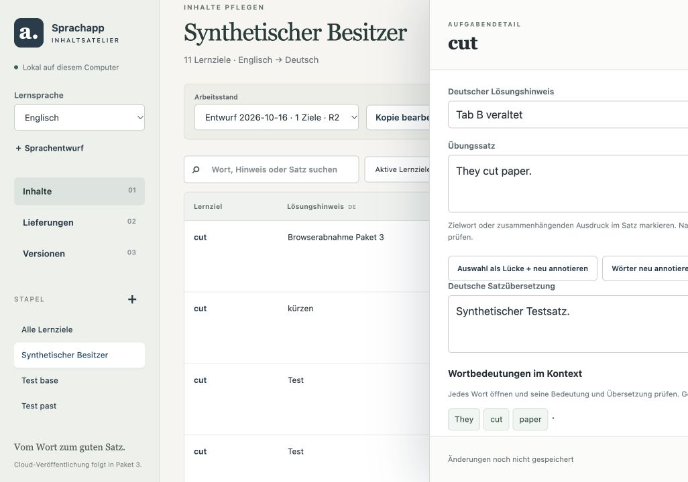
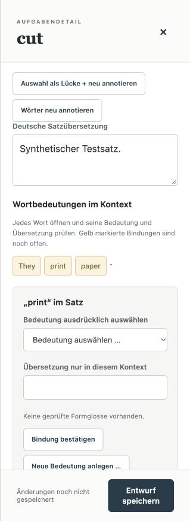
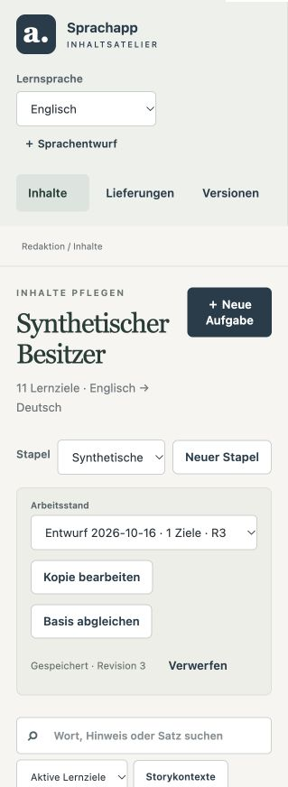

# Inhaltsupdates – Paket 3

Nachtrag 16.10.2026: E-Mail/Passwort für bestehende Identitäten ergänzt; die unten
beschriebene OTP-Anmeldung ist eine ausdrücklich gewählte Alternative.
[Einrichtung, Windows-Start, Mac/iPhone-Update und aktuelle Prüfnachweise](content-password-login.md).
Der Cloudzustand laut Auftrag (zehn angewendete Migrationen, beide Functions ACTIVE)
wurde in diesem Folgeauftrag nicht verändert; Deployment/Einladung unten nicht erneut ausführen.

Lokale Implementierung abgeschlossen; finale Prüfergebnisse unten. Reale Cloud-, Windows- und Geräteabnahme offen. Ausgangspunkt `17b9236`, Branch `codex/content-editor-package-3`. Arbeitsbaum/Index und geschützte Hashes sind unter `/tmp/sprachapp-editor-package3/` gesichert. Produktionsbasis: `story_single_sentence_v1`, Schema 4, Asset-SHA256 `b85793932825a22e92ac744a42255e9f333acd35809aaba46edb5a395f099bdb`.

## Implementierungsfolge und Dateigrenze

1. `editor/web/app.js`, `editor/service.py`, `editor/server.py`, `editor/store.py`: Arbeitsansicht dienstseitig wiederherstellen, tablokale Auswahl erhalten, asynchronen Tokeneditor gegen überholte Antworten schützen. Draft-CAS bleibt unverändert.
2. `supabase/migrations/20261017000002_content_distribution.sql`, `functions/content-publish/index.ts`, `functions/content-release/index.ts`, gemeinsame geprüfte Transporthelfer; `editor/publisher.py` und lokale UI-/Routenanbindung: OTP, private Objekte, Finalisierung, Rollen und CAS. Nur lokale Dateien/Tests, keine Cloudänderung.
3. `content_release_client.dart`, `content_install_journal.dart`, `content_update_service.dart`, `content_pack_installer.dart`: Streaming, Inhalts-/Historienprüfung, unveränderliche Generationen und Recovery.
4. `content_auth_repository.dart`, `database_providers.dart`, neue Update-/Sprachprovider, vorhandene Lern-/Story-/Deckprovider und Sessioncontroller: gemeinsamer User-DB-Owner, sprachgebundene Fassaden und sichere Aktivierungsbarriere.
5. `user_database.dart`, `drift_user_repository.dart`, Präferenzen und Settings: Schema 6, sprachbezogene Einstellungen, vollständiger Erhalt persönlicher Daten; Codegen nur falls erforderlich. Bestehende Antwort-/SRS-Semantik unverändert.
6. Gezielte Browser-, Python-, SQL/Function-, Dart-/Widget-/Migrationsprüfungen, vollständige Suites, Packtest im bisherigen Budget und Assetverify. Abhängige Rückstellung separat gegen die bestehenden Sperren prüfen; verbleibende Lücken konkret ausweisen.

## Prüfmatrix vor Implementierung

| Grenze | Nachweis |
|---|---|
| Editoransicht | Reload, Sprach-/Stapelwahl, Neustart mit anderem Port, ungültige Auswahl, zwei Tabs |
| Tokeneditor | Mehrfachklick, Tokenwechsel während laufender Anfrage, Speichern/erneutes Öffnen, exakt ein Bereich |
| Veröffentlichung B1/B2 | Rechte, unveränderliche Hashbindung, Uploadabbruch, Finalize, CAS-Rennen und idempotenter Retry |
| Installation B3/B4 | Größen-/Hash-/Schema-/Profilfehler, vollständige SQLiteprüfung, Crashpunkte, Sessionbarriere, Neustart |
| Daten B5/B6/B7 | temporäre User-DB, Migration, Sprachisolation, Review-/Notiz-/Flag-/Historienvergleich, Offline/Loginablauf |
| Schutz | geschützte Hashes, getrennte fremde Hunks, keine echte user.db/Cloud-/Geräteinstallation |

Die anfängliche Prüfmatrix ist unten mit tatsächlich ausgeführten Nachweisen und offenen externen Schritten abgeglichen. Kein Push.

## Umgesetzt und Bedienung

- Der Editor speichert Sprache, Entwurf, Stapel und Seite zusätzlich zur tablokalen Auswahl in seinem lokalen Arbeitsverzeichnis. Reload und neuer Dienstport stellen die Auswahl wieder her; verschwundene Auswahlen erhalten einen sichtbaren Rückfallhinweis. Die bestehende Entwurfsrevision/CAS bleibt maßgeblich. Ein Request-Zähler verwirft verspätete Tokenantworten; genau ein Bereich und ein Bestätigungslistener gehören zum aktuell ausgewählten Token.
- Ein Export ist an Entwurfsrevision, Inhalts-/Reviewhash, technische Prüfung und alle neun unveränderlichen Dateien gebunden. Die Versionsansicht bietet Anmeldung per E-Mail-Code, Upload, serverseitige Abschlussprüfung und gesondert bestätigte Veröffentlichung. Ein Speichern veröffentlicht nichts. Upload-/Commit-Request-IDs bleiben bei Wiederholung gleich; Kanalfortschritt erfolgt transaktional mit Elternversion und Generation als CAS.
- Private Tabellen und Bucket `content-private` sind für direkte anonyme/authentifizierte Zugriffe gesperrt. Edge Functions prüfen den JWT über Auth sowie Publisher-/sprachgebundene Leser-Listen. Nur die serverseitige Umgebung besitzt den Service-Schlüssel. Finalisierung liest und hasht sämtliche Dateien, prüft Freigabe, Inventare und Historienbasis. Downloadlinks sind kurzlebig, privat und erst nach Leserprüfung erhältlich. Abgelaufene Uploads benötigen einen neuen Export/Upload.
- Die App lädt gestreamt und größenbegrenzt in reservierte temporäre Dateien, prüft Hashes, Manifest, Profil, vollständiges SQLite-Schema und sämtliche Tabelleninventare. Vollständige Validatoren und Inhaltsabfragen laufen über Hintergrund-Isolates. Eine veröffentlichte Generation liegt unveränderlich in einem eigenen Verzeichnis. `active.json` und ein Installationsjournal schalten ausschließlich Metadaten atomar um.
- Die gebündelte Ausgangsversion wird als Bootstrap-Generation gebunden. Neuere installierte Versionen bleiben beim Neustart aktiv. Recovery unterscheidet vorbereitete und bestätigte Aktivierungen; ein beschädigter bestätigter Stand wird nicht auf das Asset zurückgesetzt. Eine streng höhere, vollständig geprüfte Generation kann anhand authentifizierter Historieninventare reparieren. Die App verändert dabei keine persönliche Datenbank.
- Übungen, Storyansichten, Wortdetails und noch laufende Schreibvorgänge halten Übergangs-Leases. Aktivierung wartet auf einen sicheren Übergang sowie das tatsächliche asynchrone Schließen der alten Leser. Repository-Owner sind nach Sprache/Generation getrennt. Der physische User-DB-Owner wird geteilt; sprachgebundene Fassaden dürfen ihn nicht selbst schließen.
- User-DB 6 migriert transaktional, erstellt zuvor ein SQLite-Backup und trennt Spracheinstellungen. IDs bereits vorhandener anderer Sprachen werden bei Zugriffen/Schreiben abgewiesen, neue Inhalts-IDs gegen den ausgewählten Bestand geprüft. Historische Reviews und Satzrevisionen bleiben unverändert. Nur das implementierte englische Profil ist veröffentlichbar; zusätzliche Sprachentwürfe bleiben lokal möglich.
- Einstellungen → Inhaltsupdates zeigt installierte Version, Anmeldung, Prüfung, Download, ausstehende Aktivierung und Fehler. Start/Fortsetzen prüft nichtblockierend, höchstens stündlich automatisch. Auth ist optional für Offline-Lernen. Sitzungen werden im Plattform-Schlüsselspeicher abgelegt; Android-Backups schließen nur dessen Tokenpräferenzen aus, nicht die Lern-Datenbank. iOS/macOS-Keychain-Konfiguration und macOS-Netzwerkberechtigung sind ergänzt.

### Dateigruppen

Zusätzlich zur anfänglichen Implementierungsgrenze: `lib/data/content/content_update_validation.dart`, `lib/presentation/providers/content_update_provider.dart`, `lib/screens/settings/content_updates_screen.dart`; Story-/Wortansichten und Sessioncontroller für Leases; `lib/data/user/user_database.g.dart` durch schemaerforderlichen Drift-Codegen; Pubspec/Lock und Plattformregistranten/Entitlements/Android-Backupregeln. Tests liegen in `pipeline/tests/test_editor_{workspace,publisher}.py`, `pipeline/tests/editor_ui_test.cjs`, `supabase/functions/_shared/content_distribution_test.ts`, `supabase/tests/database/content_distribution.test.sql`, `test/data/content_{auth,update,owner_barrier}_test.dart`, `test/data/user_language_migration_test.dart`, `test/content_updates_ui_test.dart` und `test/fixtures/private_release/`. Sechs bestehende Datentests wurden an DB6 bzw. den Bootstrap-Generationsvertrag angepasst. Ungültige Assets werden weiterhin bei frischen Installationen abgewiesen; bereits intakte Generationen bleiben auch bei einem veränderten gebündelten Asset erhalten. Fremde Übungs-UI und deren Tests wurden nicht bearbeitet.

## Reale Browserabnahme (synthetische Daten)

Im tatsächlichen In-App-Browser, eigener lokaler Dienst und eigenes Test-Arbeitsverzeichnis:

1. Entwurf bearbeiten/speichern → R2 → Reload: identischer Entwurf, Stapel und gespeicherter Text.
2. Zwei Tabs auf R2: Tab A speichert R3; Tab B erhält sichtbaren Revisionskonflikt, A bleibt erhalten.
3. Sprache `qaa` erstellen/wählen, Reload und Dienstneustart auf anderem Port: Auswahl erhalten, nicht unterstütztes Profil sichtbar. Zurück zu Englisch/R3/Stapel; weiterer Neustart auf erneut anderem Port erhält diese Auswahl und den Gewinnertext.
4. Doppelklick, Wechsel `print → paper → print` während Tokenanfragen: genau eine Bedeutungsauswahl und ein Bestätigungsbutton für `print`. Gespeicherten Entwurf wieder geöffnet: Gewinnerinhalt erhalten. Separater JS-Regressionstest reproduziert am alten HEAD zwei Bereiche und besteht mit dem Request-Schutz.
5. Ohne Cloudkonfiguration zeigt die Versionsseite die fehlende Einrichtung. Keine erfolgreiche Cloudveröffentlichung im Browser behauptet.





## Grenzen und offene Abnahmen

- **Konkrete Funktionslücke:** Rückstellen mehrgliedriger Lerngruppen mit Wahl eines neuen Gruppenkopfs und Umhängen abhängiger Besitzer-/Form-/Gruppenbindungen ist weiterhin nicht vollständig bedienbar. `_retire_target` verlangt weiterhin einen einzelnen Gruppenangehörigen und keine fremden aktiven Satz-/Storybindungen. Einfache Rückstellungen sind vorhanden; komplexe Fälle bleiben mit `RETIREMENT_DECISION_REQUIRED` gesperrt. Keine Löschung oder Umgehung dieser Sperren. Dieser Restpunkt ist ausdrücklich kein abgeschlossener Teil des Gesamtplans.
- Kein Docker/Supabase-CLI auf diesem Rechner verfügbar: SQL wurde mit echtem PostgreSQL-WASM (PGlite), synthetischen Auth-/Storage-Systemtabellen und den tatsächlichen Migrations-/Testassertionen geprüft. Der pgTAP-Wrapper wurde dort ausgelassen. Deno testet tatsächliche Handler mit simuliertem Auth/Storage-Transport. Beides ersetzt weder Supabase-Gateway-/Storage-Integration noch Cloudabnahme.
- Keine Cloudänderung, echte Veröffentlichung, Mailzustellung, reale Secure-Storage-Geräteprüfung, Windows-Dateisperrenabnahme oder iPhone-Installation durchgeführt. Insbesondere keine Installation auf „iPhone von Claus“.
- Nur Englisch unterstützt. Ein Sprachprofil samt Validator-/Reader-/Bewertungsunterstützung ist Voraussetzung weiterer veröffentlichbarer Sprachen. Kein stiller Englisch-Fallback.
- Prozessabbruch-Recovery ist mit temporären Dateien an den Journalgrenzen getestet; plötzlicher Stromverlust/Dateisystemfehler und native Windows-Sperren brauchen Plattformabnahme. Alte Generationen werden nicht automatisch gelöscht.
- Inventarprüfung berücksichtigt ausschließlich semantisch identische, beim SQLite-Export ausgelassene NULL-Felder in den bisherigen Pass-through-Tabellen. Nicht-NULL-Werte, Zeilenanzahlen, sämtliche tatsächlichen Tabellen und unveränderliche Identitäten werden vollständig abgeglichen.

## Einmalige Einrichtung – erst nach gesonderter Cloudfreigabe

Bestehendes Supabase-Projekt weiterverwenden, **kein** `supabase init` und kein produktives `db reset`. Zugangsdaten lokal verwalten, nicht im Chat/Repository. Zuerst CLI/Docker bereitstellen und die Migration gegen eine isolierte lokale Instanz prüfen. Folgende CLI-Befehle sind auf macOS (Terminal) und Windows (PowerShell) identisch:

```text
supabase start
supabase migration up --local
supabase test db
supabase functions serve
```

Anschließend reale lokale OTP-/Gateway-/Storage-Integration mit eingeladenen Testkonten prüfen, einschließlich fehlender Allowlist, abgelaufener Anmeldung, konkurrierendem Commit und unterbrochenem Upload. Diese Abnahme ist offen.

Nur nach Freigabe des tatsächlichen Projektziels, zuerst Projektzuordnung/Migrationsliste kontrollieren:

```text
supabase link --project-ref <BESTEHENDE_PROJECT_REF>
supabase migration list --linked
supabase db push --dry-run
supabase db push
supabase functions deploy content-publish
supabase functions deploy content-release
```

JWT-Prüfung bleibt aktiviert. Supabase stellt `SUPABASE_URL` und den serverseitigen Service-Schlüssel in der Function-Umgebung bereit. Keine Service-Schlüssel an Editor oder App geben. Bestehende Nutzer verwenden nun bevorzugt E-Mail/Passwort gemäß [Passwortanleitung](content-password-login.md), ohne neue Einladung, Registrierung, OTP-Mail oder Custom SMTP. Nur für die ausdrücklich gewählte OTP-Alternative muss eine Tokenvorlage mit `{{ .Token }}` und die tatsächliche Zustellung eingerichtet und geprüft sein. Die folgenden Rollenbeispiele gehören zur ursprünglichen Ersteinrichtung; vorhandene UID und Allowlist im Folgeauftrag erhalten:

```sql
insert into public.content_publishers(user_id)
values ('<EINGELADENE_PUBLISHER_UUID>'::uuid) on conflict do nothing;
insert into public.content_readers(user_id,channel,lang)
values ('<EINGELADENE_LESER_UUID>'::uuid,'internal','en') on conflict do nothing;
```

Editor starten mit Projekt-URL und **öffentlichem** Anon-Key aus lokal gesetzter Umgebung:

macOS (Terminal):
```sh
export SPRACHAPP_SUPABASE_URL="$SUPABASE_URL"
export SPRACHAPP_SUPABASE_ANON_KEY="$SUPABASE_ANON_KEY"
pipeline/.venv-macos/bin/python -X utf8 -m sprachpipe.editor
```

Windows (PowerShell; vorhandene Pipeline-venv):
```powershell
$env:SPRACHAPP_SUPABASE_URL = $env:SUPABASE_URL
$env:SPRACHAPP_SUPABASE_ANON_KEY = $env:SUPABASE_ANON_KEY
pipeline\.venv\Scripts\python.exe -X utf8 -m sprachpipe.editor
```

Für iOS einmalig einen neuen App-Build mit dieser Implementierung und den beiden öffentlichen Defines erstellen (macOS):
```sh
flutter build ios --no-codesign --dart-define="SUPABASE_URL=$SUPABASE_URL" --dart-define="SUPABASE_ANON_KEY=$SUPABASE_ANON_KEY"
```

Dies baut nur; Signierung und Installation ausschließlich auf einem ausdrücklich autorisierten Gerät separat durchführen. Danach in der App mit einem eingeladenen und freigegebenen Leser anmelden. Editor: konkrete Revision prüfen → redaktionell bestätigen → exportieren → hochladen → serverseitig prüfen → Veröffentlichung ausdrücklich bestätigen. App: automatisch/manuell prüfen → herunterladen → geprüfte Version am sicheren Übergang aktivieren. Spätere Inhaltskorrekturen benötigen dann keinen erneuten App-Build; Änderungen an App/Schema/Sprachprofil können einen neuen Build erfordern.

Quellen für Auth-/Gateway-Verhalten: [OTP](https://supabase.com/docs/reference/dart/auth-signinwithotp), [Codeprüfung](https://supabase.com/docs/reference/dart/auth-verifyotp), [Edge-Authentisierung](https://supabase.com/docs/guides/functions/auth). Tatsächliche SDK-Implementierung zusätzlich lokal geprüft.

## Prüfprotokoll

Alle folgenden Prüfungen verwenden synthetische/temporäre User-Daten. Der Produktionspack wird ausschließlich gelesen. Flutter-Läufe erfolgen nacheinander, ohne erhöhte Timeouts. Python-Befehle sind nachstehend für macOS angegeben; Windows nutzt stattdessen `pipeline\.venv\Scripts\python.exe` mit identischen Argumenten. Flutter-/Dart-/Node-/Deno-Befehle sind auf beiden Plattformen gleich.

Bereits abgeschlossene lokale Prüfungen (jeweils Exit 0):

```text
pipeline/.venv-macos/bin/python -m pytest pipeline/tests -q
547 passed, 19 subtests passed in 118.98s

node --test pipeline/tests/editor_ui_test.cjs
PASS: reverse responses, repeated click, single listener, stale detail
1 passed, 0 failed

deno test --allow-read supabase/functions/_shared/content_distribution_test.ts
ok | 5 passed | 0 failed

deno check supabase/functions/content-publish/index.ts supabase/functions/content-release/index.ts
Check .../content-publish/index.ts
Check .../content-release/index.ts

node /tmp/sprachapp-editor-package3/sql-test.mjs
PASS PostgreSQL: real migration and distribution assertions
(pgTAP wrapper excluded; no Supabase gateway)

flutter test --no-pub test/data/form_content_test.dart test/data/targeted_curation_test.dart test/data/review_flow_test.dart test/data/content_update_test.dart test/data/content_owner_barrier_test.dart
00:08 +43: All tests passed!

flutter test --no-pub test/data/content_auth_test.dart test/content_updates_ui_test.dart test/data/user_language_migration_test.dart
00:01 +4: All tests passed!
```

Deno 2.9.6 und PGlite lagen ausschließlich im temporären Testwerkzeugverzeichnis; kein zusätzlicher App-/Pipeline-Runtimepfad. Der SQL-Test lädt die tatsächliche neue Migration und die vorhandene neue SQL-Testdatei, entfernt ausschließlich die vier pgTAP-Rahmenzeilen und verwendet synthetische `auth.users`/`storage.buckets`/Rollen. Reproduzierbare native Supabase-Befehle stehen im Einrichtungsabschnitt.

Explizite Fehlerversuche: Ein Python-Lauf ohne Socketfreigabe endete mit 545 PASS/2 Setupfehlern (Sandbox `EPERM`); der vollständige Lauf mit lokalen Socketrechten besteht. Die erste Flutter-Gesamtrunde fand eine 320px-Layoutregression durch die neue Einstellungszeile; deren Position wurde korrigiert, ohne fremde Tests zu ändern. Die nächste Gesamtrunde fand drei alte Asset-Austausch-/Pfadannahmen; diese wurden auf den gebundenen Bootstrap-Vertrag umgestellt und behalten frische Negativinstallationen sowie bytegenauen Lernstandserhalt. Zwei neue Auth/UI-Tests brauchten einen synthetischen JWT mit echtem `exp`-Claim bzw. gezieltes Scrollen zur Statusmeldung; kein Produktvalidator wurde abgeschwächt. Der Journal-Schreibfehler nach Reader-Close erhielt eine Fehlerbehandlung samt Negativtest.

Logs des lokalen Laufs: `/tmp/sprachapp-editor-package3/`; Browserbilder sind dauerhaft unter `docs/evidence/content-editor-package-3/` eingecheckt.

Gesamtsuite nach den Korrekturen (Exit 0):
```text
flutter test --no-pub
01:00 +346: All tests passed!
```
Der zusätzliche Update-Test verwendet eine echte temporäre User-DB mit Karte, Lernstand, Notiz, Favorit und append-only Review. Ihre geschlossenen Dateibytes bleiben nach Download, Aktivierung, Repositoryöffnung und Neustart identisch; Satzrevision und Box werden anschließend erneut gelesen. Die separate DB6-Migrationsprüfung vergleicht jede tatsächlich vorhandene Tabelle einschließlich lokaler Story-/Formherkünfte, Einstellungen und Reports; ein erzwungener Fehler lässt auch die alte Schemanummer unverändert.

Abschließende Pflichtprüfungen (jeweils Exit 0):
```text
flutter test --no-pub test/data/real_pack_test.dart
00:12 +1: All tests passed!  [unverändertes 30-Sekunden-Limit]

flutter analyze --no-pub
No issues found! (ran in 3.4s)

dart run tool/stage_content_pack.dart --verify
verified assets/content/en/content.sqlite
version story_single_sentence_v1, schema 4, 26198016 bytes
sha256 b85793932825a22e92ac744a42255e9f333acd35809aaba46edb5a395f099bdb
22 table counts match finalization_report.json
```

Nach dem grünen Gesamtlauf ergänzte `dart fix --code=curly_braces_in_flow_control_structures` ausschließlich 38 fehlende Klammerblöcke in sechs neuen Dateien; keine Logikänderung, globale Formatierung oder Regelunterdrückung. Die anschließende Analyse ist sauber. Android-/Apple-XML ist syntaktisch geparst; dies ist keine native Build-/Geräteabnahme.

### Schutz und Committrennung

Vorab gesicherte Hashes von Asset, Manifest, Quell-/SQLite-Pack, Bewertungslogik sowie allen fremden Übungs-UI-/Testdateien bleiben identisch. Keine echte User-DB geöffnet. `NEXTSTEPS.md` bleibt bei 25 Zeilen; im Index wird ausschließlich der bisherige Paket-3-Status durch den neuen Status ersetzt, der übrige fremde Arbeitsbaumanteil bleibt ungestagt. Die eigenen Teständerungen betreffen ausschließlich saubere Dateien; fremde UI-Tests bleiben unverändert. Kein Push.

Diffchecks verwenden `git -c core.whitespace=cr-at-eol diff --check -- <eigene Dateien>` und `git -c core.whitespace=cr-at-eol diff --cached --check`, damit die bestehenden CRLF-Dateien nicht allein wegen ihrer Zeilenenden als Whitespacefehler erscheinen. Beide ohne Befund, Exit 0.

GitNexus vor Commit: vollständiger Reindex mit `node .gitnexus/run.cjs analyze --index-only --pdg --force` (Exit 0; 90.351 Knoten, 276.288 Kanten, 949 Cluster, 381 erfasste Flows). Danach strukturierte `detect_changes`-Abfragen über den lokalen Backend-Adapter: `scope=all` meldet 474 Symbole/84 Dateien/16 Prozesse, `scope=staged` ausschließlich eigene 446 Symbole/77 Dateien/16 Prozesse. Beide Ergebnisobjekte ohne `error`, `partial` oder `truncated`; Risikostufe **CRITICAL**, ausdrücklich nicht als Low umgedeutet. Betroffen sind insbesondere Publish/Release→Auth/Fetcher, Activate→Journal sowie Build→Prüfung/Owner-Pause/Close. Vor einzelnen Implementierungsänderungen lagen die dokumentierten Impact-Ergebnisse bei LOW/MEDIUM bzw. UNKNOWN; UNKNOWN-Aufrufe wurden durch tatsächliche Controller-/Handler-/Testaufrufe ergänzt.

Die vollständige Änderungsabfrage bedeutet keine vollständige statische Programmanalyse: der Index warnt vor begrenzter dynamischer/cross-language Feldauflösung und ausgelassenen Flow-Kandidaten. Diese Abdeckungsgrenzen bleiben bestehen; Quellprüfung und tatsächliche Browser-/Deno-/PostgreSQL-/Python-/Dart-/Widgettests ergänzen sie. Das CRITICAL-Integrationsrisiko wird nicht durch die grünen Tests wegdefiniert; reale Supabase-/Windows-/Geräteabnahmen bleiben Voraussetzung der jeweiligen Betriebsfreigabe.
