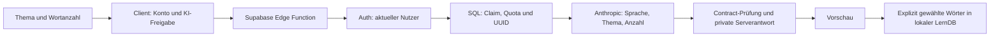

# Ergänzung: Sicherheit und Datenschutz der Themen-Generierung

**Prüfstand: 31.10.2026. Begrenzte Schlussprüfung; keine uneingeschränkte Release-Freigabe.**

Dieses Addendum ergänzt [release-security-audit.md](release-security-audit.md) ausschließlich um die neue Themen-Generierung. Authentifizierung, Quoten, gespeicherte Serverantworten, lokale Übernahme, Löschung und Einwilligung wurden anhand des aktuellen Arbeitsstands geprüft. Es gab keine Codekorrekturen, Cloudänderungen, Live-Angriffe, Schlüsselausgaben oder zusätzlichen Provider-Aufrufe. Neu erstellt wurde nur dieses Dokument.

„Belegt“ bezeichnet gelesenen Code oder unten selbst ausgeführte isolierte Tests. „Risiko“ bezeichnet eine mögliche Folge mit Voraussetzungen. „Offen“ benötigt eine manuelle Geräte-, Betriebs- oder Dashboard-Abnahme. Die Dateizeilen beziehen sich auf diesen uncommitteten Prüfstand; sie können sich bei späteren Änderungen verschieben.

## Verwendete Skills und Grenzen

Gezielt gelesen und angewandt wurden die installierten Skills:

- [`app-store-review`](/Users/ardasayar/.codex/skills/app-store-review/SKILL.md), insbesondere Checks 2.7/2.15 und Empfehlungen R13: Einwilligung, Kontolöschung und externe Nachweise.
- [`apple-app-review-skills`](/Users/ardasayar/.codex/skills/apple-app-review/SKILL.md) mit [`ai-data-disclosure`](/Users/ardasayar/.codex/skills/apple-app-review/skills/privacy/ai-data-disclosure/SKILL.md) und [`account-deletion-check`](/Users/ardasayar/.codex/skills/apple-app-review/skills/privacy/account-deletion-check/SKILL.md).
- [`vibe-security`](/Users/ardasayar/.codex/skills/vibe-security/SKILL.md), einschließlich Referenzen zu Datenbankzugriff, Authentifizierung, KI und Rate Limits.
- [`auth-assessment`](/Users/ardasayar/.codex/skills/auth-assessment/SKILL.md) und [`privacy-audit`](/Users/ardasayar/.codex/skills/privacy-audit/SKILL.md): MASVS-AUTH sowie PRIVACY, Datenminimierung, Kontowechsel und Löschung.

Die Swift-Suchmuster wurden auf die tatsächlichen Flutter-, TypeScript- und SQL-Pfade übertragen. Dies war kein erneuter Vollscan aller iOS-Targets oder der bestehenden App, keine aktuelle Rechtsberatung und keine MASVS-Zertifizierung. Die Skill-Regelbezüge 5.1.1/5.1.2 dienen der Zuordnung; eine garantierte Apple-Entscheidung wird daraus nicht abgeleitet. Der bestehende Audit bleibt für seinen damaligen Umfang bestehen, wird aber nicht als aktueller Nachweis jeder inzwischen geänderten Funktion behandelt.

GitNexus wurde zuerst zum Generierungs-/Consent-/Auth-Konzept befragt. Die neue ungetrackte Generierung erschien darin nicht als vollständiger eigener Flow; die Ergebnisse verwiesen überwiegend auf bestehende Übersetzungs-/Consentpfade. Deshalb beruht die Prüfung der neuen Dateien auf anschließender Quellcodelektüre, nicht auf einem vermeintlich vollständigen oder sauberen Taint-Graphen.

## Datenfluss und belegte Schutzmaßnahmen



| Bereich | Beleg und Aussage | Grenze |
|---|---|---|
| Provider-Secret | `supabase/functions/generate-vocabulary/index.ts:2–5` liest Service- und Anthropic-Key ausschließlich aus Server-Umgebung. `lib/data/generated_vocabulary_client.dart:117–120` sendet öffentlichen Supabase-Key und Nutzertoken an die eigene Function. | Kein neuer vollständiger History-/Release-Binary-Secret-Scan. Kein Secret im Bericht. |
| Authentifizierung | `supabase/config.toml:437–438` aktiviert Gateway-JWT. `generated_vocabulary.ts:113–114` ruft zusätzlich Auth auf; `runtime_translation.ts:178–203` verwendet `/auth/v1/user` und verwirft anonyme/ungültige Identitäten. | Tatsächlich deployte Auth-/Gateway-Konfiguration und Token-Lebenszyklus brauchen Betriebsnachweise. |
| Kontobindung | `generated_vocabulary.ts:120–122` setzt `p_user` aus der verifizierten Identität, nicht aus dem Request. SQL-Schlüssel ist `(user_id,request_id)` (`20261031000004_generated_vocabulary.sql:14`). | Kein eigener Live-Zwei-Nutzer-Zugriffstest in diesem Addendum. |
| Zugriffsschutz | SQL `:19–21` aktiviert RLS und entzieht public/anon/authenticated Tabellenrechte. RPCs haben leeren `search_path` und nur service_role-Ausführungsrechte (`:25`, `:93–98`). | Lokale Migration belegt nicht automatisch den produktiven Grant-Zustand. Keine fehlende RLS behauptet. |
| Kontoqualität | SQL `:33–36` verlangt bestätigte E-Mail und nichtanonymes Konto, bevor ein Claim erfolgt. | Keine Aussage über Bot-/Mehrkontenprävention beim Registrieren. |
| Eingaben | `generated_vocabulary_contract.ts:72–94` verlangt exakte Felder, Vertrag 1, `consent:1`, UUID, eine von fünf Sprachen, höchstens 400 Zeichen/zwei Sätze und 1–50 Wörter. Handler `generated_vocabulary.ts:194–203` begrenzt Methode, Tokenform, Queryparameter und Body auf 8192 Bytes. | `consent:1` ist eine explizite Request-Erklärung, kein serverseitiger Nachweis des zuvor dargestellten UI-Texts. |
| Ressourcen | `generated_vocabulary.ts:11–38` begrenzt Streams beim Lesen. `:139` setzt maximal 16000 Ausgabetokens; `:190–191` begrenzt die Handlerlaufzeit. Client begrenzt Antwortgröße und Gesamtdauer (`generated_vocabulary_client.dart:125–165`). | Plattform- und Providerzeitlimits sowie tatsächlich abgerechnete Kosten extern prüfen. |
| Quoten | SQL `:37–38`, `:54–66`: atomarer globaler Advisory Lock; maximal ein aktiver Versuch/Konto, fünf Versuche bzw. 250 reservierte Wörter/Konto/24 Stunden, global 20000 reservierte Wörter/24 Stunden. Fehlversuche werden nicht aus der Quote entfernt. | Eigenständige Generierungsquote; kein Nachweis eines Euro-/Dollarbudgets oder einer Premium-Berechtigung. |
| Wiederholungen | UUID, Eingabehash, Ticket und Zustände verhindern denselben bezahlten Wiederholungsaufruf (`SQL :43–55`, `:70–91`; Backend `:123–133`, `:170–181`). Status-only startet keinen Provideraufruf. | Neue UUIDs sind neue Versuche und verbrauchen Quote. Unklarer Ausgang kann bewusst nicht automatisch neu erzeugt werden. |
| Providerdaten | Backend `:139–142` übermittelt Sprache, Thema und Anzahl; der Nutzer-JWT und die User-ID sind nicht im Modell-Request. SQL `:7`, Backend `:117–119` speichert einen SHA-256-Eingabehash statt eines eigenen Klartext-Promptfelds. | Freitext kann trotzdem vom Nutzer eingegebene personenbezogene Daten enthalten. Hash plus Kontobindung ist keine Anonymisierung. Provider-/Infrastrukturlogs wurden nicht eingesehen. |
| Ausgabe | Der Server prüft Vertrag, IDs, Sprache, Einwortform, Feldlängen, Wortpositionen, Duplikate und Satzregeln. Vorschau rendert Textwidgets, keinen ausführbaren HTML-/WebView-Inhalt (`generated_vocabulary_selection_screen.dart:95–107`). | Strukturelle Gültigkeit beweist weder richtige Sprache noch richtige Übersetzung oder ungefährlichen semantischen Inhalt. |
| Lokale Übernahme | Erst die Auswahlaktion speichert Karten (`generated_vocabulary_selection_screen.dart:26–36`). Store schreibt innerhalb einer Transaktion und verifiziert am Ende erneut (`generated_vocabulary_store.dart:31–40`, `:71–105`). | Lokaler Lernbestand hat eine andere Aufbewahrung als die Serverantwort. |

Pfade der TypeScript-Dateien in dieser Tabelle liegen unter `supabase/functions/_shared/`, SQL unter `supabase/migrations/`, Dart-Dateien gemäß den folgenden vollständigen Pfaden.

## Befunde und offene Abnahmen

### G01 — Antwortbereinigung erfolgt bei Aktivität, nicht zuverlässig am 30. Tag

**Mittel; belegt im Code, tatsächliche Aufbewahrung extern offen.** `supabase/migrations/20261031000004_generated_vocabulary.sql:39–42` entfernt Antwortinhalte älter als 30 Tage nur innerhalb von `claim_generated_vocabulary`. Der Claim eines beliebigen bestätigten Kontos kann die Bereinigung auslösen, auch eine Statusabfrage; eine zeitgesteuerte Bereinigung wird in dieser Migration nicht eingerichtet. Ohne Folgeaktivität kann eine Antwort länger gespeichert bleiben. Ein externer bereits eingerichteter Scheduler wurde hier nicht geprüft.

**Folge:** Keine Zusage „nach spätestens 30 Tagen physisch gelöscht“ aus diesem Code ableiten. Das betrifft Primärdaten; Backups und Provideraufbewahrung benötigen gesonderte Fristen. Bezug: bestehendes S03, MASVS-PRIVACY-3/4. **Erforderlicher Nachweis:** tatsächlicher Löschbetrieb bei Inaktivität und passende öffentliche Aufbewahrungsaussage. Keine Bereinigung implementiert.

### G02 — Replay-Metadaten bleiben bis zur Kontolöschung erhalten

**Mittel als Transparenz-/Aufbewahrungsfrage; belegt.** Die Bereinigung leert `response`, belässt aber `user_id`, `request_id`, Sprache, Eingabehash, Anzahl, Zustand, Ticket und Zeitstempel. SQL `:39–40` benennt dies ausdrücklich als Replay-Tombstone bis zur Kontolöschung; Tabellenstruktur `:3–16` und Update `:41–42` bestätigen den Umfang. Auch fehlgeschlagene/pending Versuche bleiben erhalten.

**Folge:** Eine gelöschte Antwort ist keine vollständige Löschung des Generierungsvorgangs. Hashes einfacher, vorhersehbarer Themen können bei Zugang zum Ledger anhand bekannter Kandidaten verglichen werden; das ist kein nachgewiesener öffentlicher Zugriff. Die dauerhafte Kontobindung und der Zweck der Replay-Sperre müssen im Dateninventar und Aufbewahrungskonzept berücksichtigt werden. **Erforderlicher Nachweis:** dokumentierte Fristen/Begründung für Metadaten und tatsächlich ausgeführte Account-Cascade einschließlich Backupkonzept. Keine Metadaten gelöscht.

### G03 — Wort-/Versuchsquoten sind kein monetärer Hardcap

**Mittel als Betriebs-/Kostenrisiko; belegt begrenzte Quoten, abgeleitete Kostenfolge.** SQL `:56–63` begrenzt reservierte Wortzahlen und Kontoanfragen. Backend `supabase/functions/_shared/generated_vocabulary.ts:139` erlaubt pro Versuch bis zu 16000 Ausgabetokens. Eine globale monetäre Budgetprüfung, ein davon abhängiger Kill-Switch oder ein Gesamtlimit für alle weiteren KI-Endpunkte ist in diesem neuen Pfad nicht enthalten.

**Folge:** Unterschiedlich teure Antworten und viele bestätigte Konten können trotz vorhandener Quote Kosten verursachen oder den globalen Tagesvorrat erschöpfen. Das ist weder „unbegrenzter anonymer KI-Zugriff“ noch ein belegter Quotenbypass. **Erforderlicher Nachweis:** wirksames Providerbudget, Alarme, Verantwortliche und Abschaltweg sowie akzeptierte Kosten pro globaler Quote. Ein bloßes Billing-Warnbudget ist nicht automatisch eine technische Sperre. Keine Beträge oder Providerbedingungen wurden angenommen.

### G04 — Einwilligung vorhanden; Abdeckung des neuen Datenflusses noch manuell abnehmen

**Mittel als Release-/Transparenzprüfung; Mechanismus und Texte belegt, rechtliche Tragfähigkeit offen.** Der Generierungsclient prüft Anmeldung und `PersonalLearningClient.consent()` vor Versand und erneut während des Antwortlesens (`lib/data/generated_vocabulary_client.dart:35–85`, `:113–124`, `:131–164`). Neue Entwürfe bleiben an Konto, Sprache und Consentrevision gebunden (`lib/data/learning/generated_vocabulary_service.dart:21–42`, `:52–62`). Fehlende Freigabe blockiert den Request. Dies ist kein Befund „KI läuft ohne Einwilligung“.

Die neue Oberfläche nennt Anthropic ausdrücklich, warnt vor persönlichen Angaben und KI-Fehlern (`lib/screens/content/topic_vocabulary_composer.dart:143–145`); „Generieren“ ist eine bewusste Aktion. Die bereits vorhandene Freigabe bleibt jedoch Version 1 mit Geräte-Onboarding-Fallback (`lib/data/personal_learning_client.dart:28`, `:32–50`). Der Onboardingtext spricht von Wörtern/Satzkontext für Übersetzungen und eigene Lernkarten (`lib/screens/onboarding/onboarding_screen.dart:24–27`). Der Settings-Schalter „Private Lernkarten mit KI“ zeigt bei fehlerfreiem Zustand keinen erläuternden Untertitel (`lib/widgets/personal_learning_button.dart:320–325`). Die Konstante `personalLearningDisclosure` beschreibt Wort/Satz/Vergleichskontexte (`:22–25`), nicht ausdrücklich freie Themen und das private Serverantwort-Ledger.

**Folge:** Offen ist, ob Bestandsnutzer aus den tatsächlich sichtbaren Texten den erweiterten Zweck, serverseitige Vorschau-Speicherung, Metadatenaufbewahrung und lokale Übernahme ausreichend verstehen. Der Client übernimmt eine Gerätefreigabe gegebenenfalls für ein Konto ohne eigene gespeicherte Auswahl; das ist belegtes Verhalten, kein nachgewiesener fremder Kontozugriff. **Erforderlicher Nachweis:** sichtbaren Onboarding-/Settings-/Generierungspfad und aktuellen Privacytext zusammen abnehmen; passende App-Privacy-Angaben und reale Empfänger-/Regionen-/Aufbewahrungsinformationen prüfen. Es wurde kein neuer Dialog verlangt oder eingebaut und keine garantierte Ablehnung behauptet. Bezug gemäß Skills: 5.1.2(i), MASVS-PRIVACY-1/3/4.

### G05 — Kontolöschung erfasst Server-Ledger; lokale Wörter bleiben bewusst auf dem Gerät

**Mittel, datenabhängig; Codeverhalten belegt, vollständige Löschung manuell offen.** Das Ledger referenziert `auth.users(id) on delete cascade` (`supabase/migrations/20261031000004_generated_vocabulary.sql:4`). Der vorhandene Account-Handler verlangt frische Authentifizierung, löscht gegebenenfalls das Adapty-Profil und anschließend den Auth-Nutzer (`supabase/functions/_shared/account_deletion.ts:96–118`). Die SQL-Testdatei enthält einen Cascade-Nachweis; sie wurde für dieses Addendum gelesen, nicht erneut gegen eine Datenbank ausgeführt.

Lokal landen gewählte Wörter, Bedeutungen, Beispielsätze und Übersetzungen in der regulären LernDB (`lib/data/user/generated_vocabulary_store.dart:71–94`). Die neue Mitgliedschaftstabelle und Schema 8 besitzen Sprach-, aber keine Cloudkonto-Spalte (`lib/data/user/user_database.dart:146–153`, `:278–286`). Die Löschoberfläche sagt ausdrücklich „Dein lokaler Lernstand auf diesem Gerät bleibt erhalten“ (`lib/widgets/account_tile.dart:131–147`). Das ist keine heimliche Cloud-Synchronisierung und kein Remote-IDOR. Auf einem geteilten Gerät kann der bewusst gerätebezogene Lernbestand aber nach Kontowechsel weiter sichtbar sein; vollständige Löschung lokaler KI-Inhalte ist durch die Kontolöschung nicht belegt.

**Erforderlicher Nachweis:** Nutzererwartung „Konto löschen“ versus „Lerndaten auf diesem Gerät löschen“ konsistent beschreiben und auf Gerät einschließlich SQLite-Neben-/Recoverydateien prüfen. Plattformbackup und lokale Dateisicherheit benötigen den tatsächlichen Release-Build; aus dem historischen S02 wird hier keine aktuelle fehlende Android-Backupregel abgeleitet. Apple-Token-Widerruf bleibt im vorhandenen Ablauf ein manueller Hinweis (`account_tile.dart:138–147`), keine automatische API-Revocation. Dieser Bestandsaspekt wurde nicht geändert und kann nicht durch die neue SQL-Cascade als erledigt gelten.

### G06 — Sprach-/Inhaltsqualität und Prompt Injection sind durch den Contract nicht ausgeschlossen

**Niedrig bis mittel als Inhaltsrisiko; strukturelle Kontrollen belegt, semantische Folge abgeleitet.** Systemanweisungen behandeln das Thema als unvertrauenswürdige Daten und verbieten unter anderem persönliche Diagnosen/Behandlungsempfehlungen (`supabase/functions/_shared/generated_vocabulary.ts:50–57`). Es gibt keine Tools, frei wählbare Ziel-URLs oder vom Modell ausgeführten SQL-Befehle. Der Contract prüft Form und Grenzen, besitzt aber keinen unabhängigen semantischen Sprach-/Sicherheitsklassifikator.

**Folge:** Ein formal passender Beispielsatz kann falsch, sprachlich unpassend oder inhaltlich ungeeignet sein. Die private Vorschau und bewusste Wortauswahl begrenzen die Übernahme, ersetzen aber keine Inhaltsabnahme. Kein erfolgreicher Prompt-Injection-Angriff oder medizinischer Ratschlag wurde in dieser Prüfung erzeugt. **Erforderlicher Nachweis:** redaktionelle synthetische Stichproben aller fünf Sprachen und Themen einschließlich unangemessener Eingaben; Alters-/Metadatenbeschreibung daran ausrichten. Keine neuen Live-Prompts ausgeführt.

## Selbst ausgeführte Prüfungen

| Prüfung | Ergebnis | Aussagegrenze |
|---|---|---|
| Node Contract-/Backendtests mit Mock-Fetch | **23 bestanden, 0 fehlgeschlagen** | Auth-/Quota-Ablehnung vor Provider, fehlende Freigabe, UUID-/Status-Reuse, parallele Klicks, verlorene Speicherbestätigung, Zeitlimits, valide/ungültige Ausgabe. Kein Live-Provider-/Datenbanktest. |
| Flutter Client-/Store-/Lernintegration | **24 bestanden; `All tests passed!`** | Auth/Consent/HTTPS, Antwort- und Kontowechselkontrollen, lokale Auswahl und Offline-Lernen nach Neustart in fünf Sprachen. Keine Geräte-/Backup-/Cloudfreigabe. |
| SQL-Migration und vorhandene pgTAP-Datei | **Statisch gelesen** | Grants, atomare Quote, Retention und Cascade nachvollzogen. Dieser Auditlauf führte kein SQL gegen die Cloud aus. |
| Vorherige Remote-Smokes | **Vom übergeordneten Arbeitslauf berichtet: HTTP 200 für alle fünf Sprachen mit synthetischen Daten** | Hier nicht erneut ausgeführt oder anhand neuer Remote-Ausgaben verifiziert; belegt allein keine fremden Zugriffsverbote, Kostenobergrenze oder vollständige Löschung. |

Ausgeführte Befehle (identisch in PowerShell auf Windows und Terminal auf macOS):

```text
node --experimental-transform-types --test supabase/functions/_shared/generated_vocabulary_contract_test.ts supabase/functions/_shared/generated_vocabulary_test.ts
flutter test test/data/generated_vocabulary_client_test.dart test/data/generated_vocabulary_store_test.dart test/generated_vocabulary_learning_integration_test.dart
```

Der erste Node-Versuch mit ausschließlich `--experimental-strip-types` konnte TypeScript-Parameter-Properties nicht ausführen: zehn Contracttests bestanden, die Backendsuite lud nicht. Der erneute Lauf mit `--experimental-transform-types` bestand alle 23 Tests. Das war ein Runnerproblem, kein verdeckter Anwendungstestfehler und kein Anlass für eine Codeänderung.

## Verbleibende Freigabenachweise

1. Produktive SQL-Rechte/RLS und Function-Version read-only mit der geprüften Migration abgleichen; Zwei-Nutzer- und anon/RPC-Ablehnung mit autorisierten synthetischen Konten nachweisen.
2. Providerbudget, globale Kosten-/Missbrauchsgrenzen und betriebliche Abschaltung dokumentieren. Positive HTTP-200-Smokes genügen hierfür nicht.
3. Antworten, Metadaten, Backups und Providerdaten getrennt inventarisieren; tatsächliche Bereinigung bei Inaktivität und nach Kontolöschung nachweisen.
4. Sichtbare Consent-/Privacytexte am Releasegerät einschließlich Bestandsnutzerpfad prüfen. Keine rein europäische Verarbeitung zusagen.
5. Kontowechsel, Widerruf während laufender Generierung, Accountlöschung und verbleibende lokale Wörter am Gerät prüfen; lokale Löschung und Backups getrennt behandeln.
6. Inhaltliche Stichproben aller fünf Sprachen sowie Review-Zugang und Erreichbarkeit der Function im tatsächlichen Release dokumentieren.

Die historische Aussage S01 „Logout widerruft keine Serversitzung“ wird hier nicht pauschal fortgeschrieben: Der aktuelle `lib/data/content/content_auth_repository.dart:208–215` versucht inzwischen die Abmeldung der aktuellen Supabase-Sitzung und toleriert Offlinefehler. Ein nachweislich erfolgreicher serverseitiger Widerruf jedes Tokens oder aller anderen Sitzungen ist damit weiterhin nicht belegt. Dies ist ein Hinweis auf den geänderten Prüfstand, keine vollständige Neuabnahme der alten Auth-Befunde.

**Ergebnis:** Im neuen Pfad wurde kein bestätigter Auth-Bypass, Secret-Leak oder fremder Ledgerzugriff festgestellt. Die belegten Kontrollen und bestandenen isolierten Tests unterstützen die Funktion; G01–G06 und die manuellen Nachweise begrenzen die Release-Aussage. Sämtliche Befunde bleiben unbehandelt, wie beauftragt.
