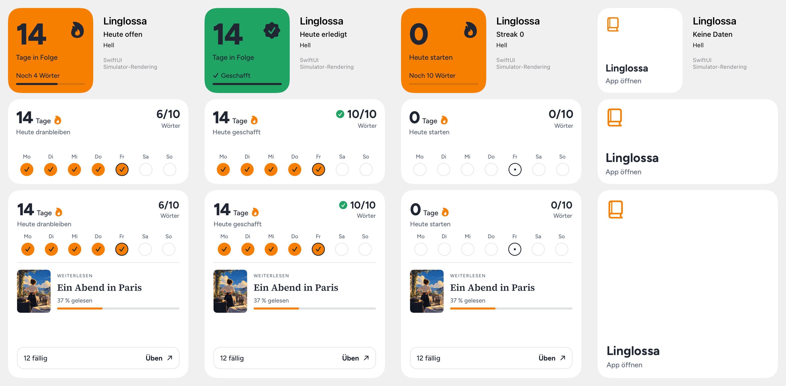
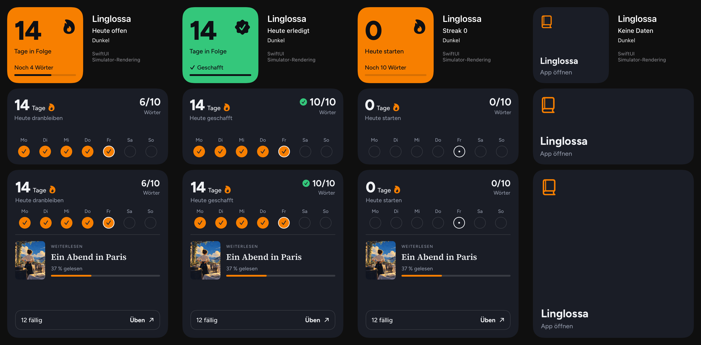

# App-Store-Vorbereitung

Auftrag vom 13. November 2026, direkt im bestehenden Projektordner. Branch: `feature/store-readiness`, Ausgangscommit: `0f00682`. iPad-Konfiguration, lokale Inhaltspakete, `config/adapty.local.json` und `appstore_ranking_reddit.md` bleiben unverändert. Kein Upload, Push oder Eingriff in App Store Connect.

## Ausgangsprüfung

```text
git branch --show-current: ui-polish-launch-screen
git rev-parse --short=7 HEAD: 0f00682
git status --short: ?? appstore_ranking_reddit.md
No issues found! (ran in 7.4s)
02:14 +1146 ~9: All tests passed!
```

Die bestehende Testsuite gibt Warnungen über nicht gebündelte Google-Fonts aus; sie endet ohne Fehlschlag. Kein Golden wurde aktualisiert.

## Teil 1 – Deutsch als App-Sprache

Commit: `0335d68` (`Set German as the app and platform language`).

- `lib/main.dart`: festes `Locale('de')`, nur Deutsch als unterstützte Oberflächensprache, alle drei Global-Delegates für Material, Cupertino und Widgets. Die gewählte Lernsprache bleibt unabhängig.
- `pubspec.yaml`, `pubspec.lock`: `flutter_localizations` aus dem Flutter-SDK ist jetzt eine direkte Abhängigkeit; die bereits transitiv vorhandene Version bleibt gleich.
- `ios/Runner.xcodeproj/project.pbxproj`: `developmentRegion = de`, `knownRegions = (de, Base)`.
- `ios/Runner/Info.plist`: `CFBundleLocalizations = [de]`; die bestehenden iPad-Orientierungen und Gerätefamilien bleiben unverändert.
- Android: `android:localeConfig` verweist auf das neue `android/app/src/main/res/xml/locales_config.xml` mit `de`. Die deutschen Flutter-Systemtexte gelten auch unter Android; auf Android 13+ wird die unterstützte App-Sprache zusätzlich dem System gemeldet.
- `test/app_locale_test.dart`: tatsächliche App-Wurzel bei englischer Gerätesprache, deutsche Material-/Cupertino-Zwischenablagebeschriftung, Zurück-Tooltip, Tausenderpunkt und Datum. Das SDK übersetzt „Paste“ mit „Einsetzen“. Keine bestehenden Tests angepasst.
- `docs/code-map.md`: Sprachkonfiguration und Prüfpfad ergänzt.

Die vorhandenen eigenen Datumsanzeigen verwenden weiterhin `formatDateDe`; Preise kommen weiterhin fertig formatiert aus dem Store. Es wurde kein globales `Intl.defaultLocale` gesetzt. Material-Systemformate wechseln beabsichtigt zu Deutsch, beispielsweise `1.234` und `12. März 2027`.

Prüfung:

```text
No issues found! (ran in 8.9s)
02:19 +1147 ~9: All tests passed!
Formatted 2 files (0 changed) in 0.04 seconds.
ios/Runner/Info.plist: OK
ios/Runner.xcodeproj/project.pbxproj: OK
iPad orientations unchanged; CFBundleLocalizations: ['de']
```

GitNexus wurde nach einem veralteten, inkonsistenten MCP-Ergebnis vollständig neu aufgebaut. Die frische CLI-Abfrage bindet den richtigen Projektordner und bewertet `SprachApp` mit `LOW`; Quelltextprüfung bestätigt App-Start, Browser-Vorschau und App-Wurzeltests als Verbraucher. Der Änderungscheck meldet niedrige Auswirkungen. Die CRLF-Zeilenenden bestehender Dart-Dateien werden erhalten.

Nach deinem nächsten Upload: App Store Connect → Apps → Linglossa → TestFlight → iOS → passende Version und Build öffnen → „Build Metadata“/„Build-Metadaten“. Dort die vom Build erkannten Lokalisierungen/Sprachen auf Deutsch prüfen. Die primäre Sprache der Store-Beschreibung ist eine getrennte Metadaten-Einstellung. Nach Veröffentlichung zusätzlich auf der öffentlichen Produktseite unter Informationen → Sprachen prüfen. Der Upload und die Anzeige in App Store Connect wurden hier nicht durchgeführt bzw. bestätigt. [Apples Anleitung zu Build-Metadaten](https://developer.apple.com/help/app-store-connect/manage-builds/view-builds-and-metadata/), [Flutter-Lokalisierung](https://docs.flutter.dev/ui/internationalization), [Android-App-Sprachen](https://developer.android.com/guide/topics/resources/app-languages).

## Teil 2 – Systembewertung nach Übungserfolg

Commit: `1fe0a79` (`Request native reviews after established practice milestones`).

Nur der echte Übungsabschluss aktiviert die Anfrage. Sie wartet auf das Ende der Abschlussanimation; bei reduzierter Bewegung reicht der erste fertig dargestellte Frame. Eine erste abgeschlossene Übung wird ausschließlich lokal vermerkt. Ab einer weiteren Sitzung und mindestens drei aktiven Lerntagen darf ein erreichtes Tagesziel oder ein Wochenstern eine Anfrage auslösen. Es gibt weder Vorabfrage noch Bewertungsknopf, Paywall-Auslöser oder Filter nach Zufriedenheit.

Die reine Funktion `shouldRequestReview` in `lib/domain/review_request.dart` prüft alle Bedingungen, mindestens 120 Tage Abstand und maximal drei Anfragen in einem rollierenden 365-Tage-Fenster. Auch eine zurückgestellte Uhr kann die Sperre nicht umgehen. `ReviewRequestService` serialisiert Aufrufe, entdoppelt Sitzungen und speichert den Zeitpunkt vor dem nativen API-Aufruf in `ui/review_requests.json`. Die Historie gilt geräteweit über Sprach- und Kontowechsel hinweg und wird nicht synchronisiert. Speicher-/Storefehler unterbrechen das Lernen nicht; ein fehlgeschlagener Schreibvorgang verhindert die Anfrage.

Dateien: `lib/domain/review_request.dart`, `lib/data/review/native_review_gateway.dart`, `lib/presentation/review/review_request_service.dart`, `lib/presentation/providers/review_request_provider.dart`, `lib/screens/completion/practice_completion_screen.dart`, `test/review_request_test.dart`, `test/review_completion_test.dart`, `pubspec.yaml`, `pubspec.lock`, automatisch erzeugter macOS-Plugin-Registrant sowie diese Dokumentation und `docs/code-map.md`.

Neue Abhängigkeiten: `in_app_review 2.0.12`, transitiv `in_app_review_platform_interface 2.0.5`. Die Plattformabfrage erlaubt ausschließlich iOS und Android; auch der automatisch erzeugte macOS-Registrant aktiviert deshalb dort keine Bewertungsabfrage.

15 neue Tests: reine Regel, Erstnutzung, Ziel-/Streak-Auslöser, Zeitgrenzen, Jahreslimit, Neustart/Persistenz, Konkurrenz/Entdoppelung, Fehler, fehlender Store, Web/Desktop, verlassener Bildschirm, echter Abschluss mit/ohne Animation und Vorschau. Keine bestehenden Tests oder Goldens geändert.

```text
No issues found! (ran in 10.8s)
02:36 +1162 ~9: All tests passed!
Formatted 7 files (0 changed) in 0.05 seconds.
```

Die sichtbare Darstellung des Systemdialogs entscheidet iOS/Android. Tests belegen die Aufrufe mit Fake, nicht die tatsächliche Anzeige auf dem Gerät. Unter TestFlight zeigt `requestReview()` keinen Dialog; ein lokaler Entwicklungsbuild kann ihn bei einem zulässigen API-Aufruf zeigen. Die App-eigenen Schutzregeln gelten auch dort. [Paketdokumentation und Testbedingungen](https://pub.dev/packages/in_app_review).

GitNexus hatte vor dem Eingriff für `PracticeCompletionScreen` `HIGH` gemeldet: echte Übung, Vorschauen und Shell-Einstiege teilen den Screen. Deshalb ist die neue Wirkung ausschließlich auf dem echten Übungsweg aktiviert; die Vorschau bleibt durch einen eigenen Test abgesichert.

## Teil 3 – Lokale Erinnerungen

Commit: `c97a1f3` (`Add local learning and verified trial reminders`).

Die Einstellungen enthalten jetzt einen Schalter und eine Uhrzeit für Lern-Erinnerungen. Die Systemfrage erscheint erst beim Einschalten oder nach einem erfolgreichen Kauf mit anschließend sicher bestätigtem Gratis-Trial. Startup, Wiederherstellen und bloße Trialberechtigung fragen nicht. Die kurze Mitteilung lautet „Zeit für ein paar Wörter / Deine nächste Runde wartet.“ Ein Tap wartet nötigenfalls auf Konto und Lernsprache und startet dann die gemischte Übung; veraltete oder nicht passende Payloads führen zu Home. Der „Bald“-Chip entfällt.

`NotificationService` besitzt eine serialisierte Queue und prüft nach asynchronen Schritten erneut die Identität. Einstellungen liegen lokal je gehashter Kontoidentität, ohne E-Mail. Logout/Kontowechsel räumen die geplanten Termine des vorherigen Kontexts auf. Für heute wird bei erreichtem Tagesziel kein Lerntermin erzeugt; App-Öffnung, Übungen, Sprach- und Zeitzonenwechsel erneuern die Planung. Maximal 30 einzelne Lerntermine und ein Trialtermin bleiben unter iOS' Grenze von 64 ausstehenden lokalen Mitteilungen. Web/Desktop planen nichts. Android verwendet bewusst ungenaue OS-Alarme ohne Sonderrecht für exakte Alarme.

Die reine Zeitfunktion verwendet IANA-Kalendertage. Eine nicht existierende Sommerzeit-Uhrzeit rückt auf die erste gültige Minute desselben Tages; eine doppelte Uhrzeit wird nur beim ersten Auftreten verwendet. Vollständig übersprungene Kalendertage erzeugen keinen doppelten Termin. UTC-/GMT-Aliase sind explizit unterstützt, unbekannte geographische Zeitzonen werden nicht erraten.

Adaptys aktives Access-Level und die passende Subscription liefern `activeIntroductoryOfferType`, `expiresAt`, `willRenew` und `isSandbox`. Produkt, Store, Angebot und Ablauf müssen intern zusammenpassen und mit dem bestätigten Kaufstatus des aktuellen Kontos übereinstimmen. Nur `free_trial`, zukünftiger Ablauf und erlaubte Verlängerung führen zu einem Plan. Produktion: einen Tag vorher; Sandbox: 30 Sekunden vorher. Kündigung, Umwandlung, Erstattung, Grace Period, fehlende/abweichende Daten oder bereits vergangener Erinnerungszeitpunkt entfernen den Plan. Auch Änderungen nur am Verlängerungsflag oder Angebot lösen jetzt den bestehenden Serverabgleich aus. Premium selbst wird dadurch nicht gewährt.

Die Paywall zeigt „Erinnerung“ erst bei erlaubten Mitteilungen und einem tatsächlich erfolgreich geplanten zukünftigen Trialtermin. Ein Angebotskatalog verspricht keine Erinnerung im Voraus. OS-Fokus, abgeschaltete Mitteilungen und iOS-Zustellung bleiben außerhalb der App-Kontrolle. Ebenso kann eine vollständig geschlossene App eine spätere externe Kündigung erst beim nächsten Öffnen/SDK-Update verarbeiten; dafür wurde kein unzuverlässiger Hintergrund-Polling-Mechanismus behauptet. Nach 30 Tagen ohne App-Öffnung endet der begrenzte Lernplanungshorizont.

Dateien: neue Domainregeln, Notification-Gateways/-Service/-Provider und AppLaunchIntent-Dateien laut `docs/code-map.md`; bestehende `main.dart`, `app_shell.dart`, `settings_screen.dart`, `paywall_screen.dart`, `adapty_billing_gateway.dart`, `billing_provider.dart`, `purchase_provider.dart`; Android-Manifest/Buildkonfiguration/Statusicon; iOS-AppDelegate; Paketdateien und generierte Registranten. Neue Abhängigkeiten: `flutter_local_notifications 23.0.2`, `flutter_timezone 5.1.1`, `timezone 0.11.2`. Die Android-Anforderungen des Pakets setzen compileSdk 37, AGP 9.1.1 und Core-Library-Desugaring 2.1.4 voraus. iPad-Einstellungen bleiben unverändert.

Bestehende Billing-/Purchase-Testfixtures wurden um das optionale Trialprofil erweitert. Neue Fälle prüfen Profilrennen und Änderungen nur an Angebot/Verlängerung; vorhandene Assertions wurden nicht abgeschwächt. Weitere Formatänderungen stammen von `dart format`. Neue Tests prüfen reine Zeit-/Trialregeln, Fehler und Cleanup, Berechtigungsmomente, gefälschte/veraltete Payloads, kalten und warmen Start, Settings-Uhrzeit und das tatsächliche Paywallversprechen. Kein Golden geändert.

GitNexus bewertete vor Änderungen Settings mit HIGH und Paywall mit CRITICAL; beide teilen viele Einstiege. Der Eingriff bleibt auf Erinnerungseinstellungen und den konditionalen Timeline-Schritt begrenzt. BillingProfileSnapshot war im Graphen nicht zuverlässig auflösbar; Quelltextprüfung erfasste alle Record-Produzenten und Fakes.

```text
No issues found! (ran in 13.1s)
04:14 +1206 ~9: All tests passed!
Formatted 24 files (0 changed) in 0.33 seconds.
```

Die vollständige Suite wächst gegenüber Teil 2 um 44 Tests; alle bestehenden Goldens bleiben unverändert. Die bereits im Ausgangsstand vorhandenen Google-Fonts-Warnungen erscheinen weiterhin, ohne Fehlschlag. Zusätzlich sind die nativen Initialisierungssemantiken des Pakets per MethodChannel-Fake geprüft: iOS darf bei bewusst ausgeschalteter automatischer Permissionfrage `false` zurückgeben, ohne dass die Initialisierung fehlgeschlagen ist. Eine verspätete Kaufbestätigung fragt nur im Vordergrund.

Der frisch neu aufgebaute GitNexus-Graph und MCP-Änderungscheck erfassen vollständig 268 Symbole in 41 geänderten Dateien, sieben betroffene Benachrichtigungsflüsse, Risiko HIGH; `partial=false`, `truncated=false`. Die zusätzliche native Widget-Metadatenvorbereitung ist noch uncommitted und nicht Teil dieses Benachrichtigungscommits. Die relevanten Queue-, Cleanup-, Permission- und Tap-Flüsse sind durch die neuen Tests abgedeckt.

Quellen: [Adapty-Flutter-Modelle](https://adapty.io/docs/flutter-sdk-models), [flutter_local_notifications](https://pub.dev/packages/flutter_local_notifications), [Zeitzonenpaket](https://pub.dev/packages/timezone).

## Teil 4 – Drei native iOS-Widgets

Die Recherche mit 13 tatsächlich geöffneten Refero-Widgetbildern, Auswahl und drei Entwürfen wurde vor der Umsetzung dokumentiert: [Referenzen und Entwürfe](store-readiness-widget-research.md). Besonders übernommen wurden Imprints/ Clearfuls Kalenderkonturen, die konkrete Lesefortsetzung aus Apple Books/PocketShelf und die kurze Zahlenhierarchie von Train Fitness. Es gibt kein Maskottchen: große Figtree-Zahlen, Flamme, echte Cover und Source Serif 4 für Storytitel bilden die eigene Gestaltung.

| Größe / Galerie-Name | Inhalt | Tap |
| --- | --- | --- |
| Klein – Streak | Große Zahl, kurzer Tagesstand; Orange offen, Grün geschafft | Gemischte Übung |
| Mittel – Diese Woche | Streak, Tagesziel und Mo–So mit echten aktiven Tagen | Gemischte Übung |
| Groß – Weiterlernen | Woche, zuletzt begonnene redaktionelle Story samt Cover/Fortschritt, fällige Wiederholungen | Getrennte Links zu Story und Übung |

Alle Größen zeigen bei fehlenden Daten „Linglossa / App öffnen“ ohne frühere Zahlen oder Story. Streak 0, heute offen und heute geschafft sind mit Text/Form und Farbe unterscheidbar. Titel-Folgezeilen stehen in Medium. Kleine Texte auf Orange/Grün sind dunkel, damit sie ausreichenden Kontrast haben. Die Extension übernimmt vier OFL-Schriften samt Lizenzen. Bei großen Textgrößen weicht sekundäre Dekoration; die vollständige Information bleibt per VoiceOver verfügbar. Es gibt keine Animation.

Das Target `LinglossaWidgetsExtension` wurde über Xcodes Oberfläche angelegt und im Runner eingebettet. Beide Targets verwenden `group.com.ardasayar.linglossa`; Team und automatisches Signing entsprechen dem bestehenden Projekt. Die Version/Buildnummer der Extension kommt über `ios/Flutter/Widget.xcconfig` aus derselben Flutter-Konfiguration wie der Runner. iPad-Einstellungen des Runners sind unverändert. Die Extension unterstützt iOS 15+, Swift 6 mit vollständiger Concurrency-Prüfung; neuere Rendering-APIs sind entsprechend geschützt.

`learningWidgetSnapshotProvider` projiziert Konto, aktive Sprache, Lernziel, Streak, lesbare redaktionelle Bibliothek, Lesestand und dieselbe Kartenmenge wie die Vokabelansicht. Die reine Domainfunktion speichert Fälligkeitszeitpunkte, keine abgeleiteten Vokabelzähler. Private Importtitel/-texte und Kontoidentifikatoren fehlen vollständig. Cover werden ausschließlich aus erlaubten eingebauten Assets kopiert, mit einem Dateinamen aus dem Inhalts-Hash; dadurch verweist eine ältere Timeline nicht versehentlich auf ein inzwischen anderes Bild.

`WidgetSnapshotService` serialisiert App-Group-Schreibvorgänge. Logout-/Sprachwechsel-Tombstones werden auch dann geschrieben, wenn danach eine neue Projektion scheitert. Die App aktualisiert bei Lern-/Lesefortschritt, Konto-/Sprachwechsel und beim Öffnen/Verlassen. Die native Timeline berechnet Tagesziel, Serie, Woche und Fälligkeiten für jeden Eintrag neu; sie enthält sieben Mitternachts-Fallbacks und bis zu 48 weitere Fälligkeitszeitpunkte vor der nächsten Mitternacht. WidgetKit bestimmt den tatsächlichen Refresh-Zeitpunkt.

`linglossa://…?homeWidget=1` wird ausschließlich über den Widget-Pluginpfad verarbeitet. Kalte und warme doppelte Callbacks werden entdoppelt. Ein Story-Tap wartet auf Sprache, Bibliothek und Kaufstatus; bei falscher Sprache, fehlendem Inhalt oder gesperrtem Zugang landet er auf Home. Eigene Importe sind kein Widget-Ziel. Die neue Abhängigkeit ist `home_widget 0.10.0`.

Dateien: `ios/LinglossaWidgets/{LinglossaWidgets,WidgetSnapshot,WidgetViews}.swift`, zugehörige Plists/Entitlements/Fonts/Assets, Xcode-Projekt, Runner-Info/Entitlements und `ios/Flutter/Widget.xcconfig`; `lib/domain/widget_snapshot.dart`, `widget_launch_intent.dart`, `app_launch_intent.dart`; `lib/data/widgets/`; `lib/presentation/widgets/widget_snapshot_service.dart`, `P/widget_provider.dart`; App-Wurzel und Shell; drei neue Widget-Darttests und vier zusätzliche Story-Zielfälle im vorhandenen `app_launch_intent_test.dart`. Dessen bisherige Assertions bleiben erhalten. Swift-Modeltests liegen in `ios/WidgetTests/`, ihr isoliertes Package in `ios/Package.swift`. Reproduzierbares natives Rendering: `tool/widget_qa/`.

### Screenshots

Die 24 geforderten Einzelbilder sowie Übersichten, große Textgrößen und Vorschauen des akzentuierten Codezweigs liegen unter [Widgets](store-readiness/widgets/). Das Manifest benennt Renderlauf und Zustand. Sie stammen aus echten SwiftUI-Renderings auf einem iOS-Simulator mit synthetischen Daten und einem bestehenden Katalogcover.





Die getönten Vorschauen prüfen den entsprechenden SwiftUI-Codezweig. SpringBoards endgültige getönte/klare Glasdarstellung, die reale App-Group-Kommunikation und Widget-Taps auf dem iPhone sind damit noch nicht belegt.

Die separaten Swift-Modeltests enden mit `Test run with 14 tests in 0 suites passed after 0.041 seconds.` Der produktive Swift-Code besteht außerdem den strikten Swift-6-Typcheck mit Deployment Target iOS 15. Keine bestehenden Goldens wurden geändert.

Der vollständige Release-Build mit `flutter build ios --no-codesign` hat die native Extension tatsächlich in `Runner.app/PlugIns` eingebettet. Host und Extension melden dieselbe Version `1.0.0 (1)` und Deutsch; alle vier im Info.plist eingetragenen Fonts sind im Extension-Bundle vorhanden. Der erste Build deckte einen falschen relativen xcconfig-Pfad auf; der Pfad ist korrigiert. Der erfolgreiche Lauf endete mit:

```text
Xcode build done.                                           265,3s
✓ Built build/ios/iphoneos/Runner.app (359.3MB)
iPad orientations and all existing device families unchanged.
Host and widget App Group match.
```

Flutter meldet für das bereits vorhandene `flutter_tts` die noch fehlende Swift-Package-Manager-Unterstützung; aktuell baut es erfolgreich über CocoaPods. Der unsignierte Build belegt Kompilierung und Einbettung, noch keine Gerätesignatur oder Zustellung.

Ein zusätzlicher Review fand einen Kaltstartfall: Der Reader durfte erst nach dem asynchron geladenen lokalen Lesestand öffnen. `ReadingProgressNotifier.ready` und `readingProgressReadyProvider` in `reading_providers.dart` sowie verzögerte Speicher-Fakes sichern diesen Fall; Konto-, Sprach- und Sync-Neuladen setzen die Bereitschaft zurück, auch wenn der bisherige Store leer war. Acht zusätzliche Fälle prüfen Fortschritt, leeren Store, Fehler, Kontextwechsel und neueren Tap. Die bereits vorhandene Persistenz-, Merge- und Speicherlogik bleibt erhalten; vorhandene Tests wurden nicht abgeschwächt.

Abschließende Prüfung des korrigierten Stands:

```text
No issues found! (ran in 7.2s)
02:03 +1230 ~9: All tests passed!
Formatted 14 files (0 changed) in 0.03 seconds.
Xcode build done.                                           95,9s
✓ Built build/ios/iphoneos/Runner.app (359.3MB)
```

Damit kommen gegenüber Teil 3 insgesamt 24 Flutter-Tests und zusätzlich 14 native Swift-Modeltests hinzu. Der finale GitNexus-Check ist ausdrücklich an den aktuellen Checkout-Pfad gebunden: 175 geänderte Symbole in 97 Dateien, LOW, `partial=false`, `truncated=false`. Es wurden keine zusätzlichen indexierten Prozesse zugeordnet; das ist keine Aussage über fehlende Laufzeitabhängigkeiten der Flutter/Swift-Brücke. Deren Snapshot-Vertrag, Timeline, Navigation, Bundle und Konto-/Speicherwechsel sind separat geprüft. Die vorangehende Lesestand-Auswirkungsanalyse war MEDIUM (Home, Reader, Sync, Onboarding und Widget als Verbraucher); der dynamische Notifier-Build war UNKNOWN und wurde zusätzlich über die Registrierung und konkrete Regressionstests geprüft.

## Noch offen

Barrierefreiheit und Geräteinstallation folgen im letzten Teil.
